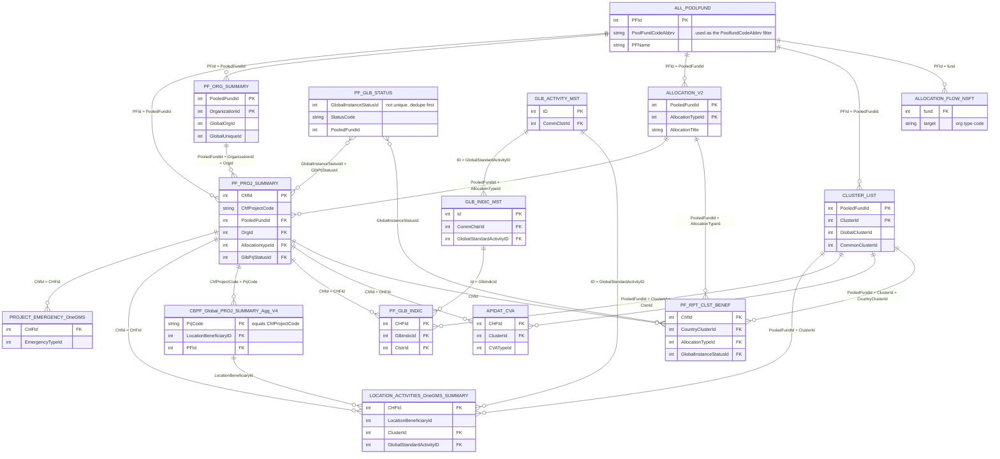

# CBPF API – Additional APIs Reference

> ⚠️ **Important (found 2026-09-29): this guide was built against `cbpfapib.unocha.org`, which is not the address the public CBPF Data Hub uses.** The Data Hub (<https://cbpf.data.unocha.org>) reads from **`cbpfapi.unocha.org`** (no "b"). The two return very different data:
>
> | | `cbpfapi` (Data Hub) | `cbpfapib` (this guide) |
> |---|---|---|
> | Datasets listed on the vo3 portal | 127 codes | 49 codes |
> | Pooled funds (`ALL_POOLFUND`) | 295 | 21 |
> | Projects (`PF_PROJ_SUMMARY`) | 15,912, starting 2013–2026 | 484, 2026 only |
> | US contributions, fiscal 2026 | $3.75 billion paid, 21 funds | $1.95 billion pledged, 18 funds |
> | All contributions, fiscal 2026 | $4.52 billion, 48 donors | $2.11 billion, 15 donors |
> | Contributions, fiscal 2025 | $886 million | $886 million (same) |
>
> The endpoints and field names are the same, but the "2026 only" findings, row counts, US shares and match rates below come from `cbpfapib`. They need re-checking against `cbpfapi` before use.

A guide to the 19 public datasets in the **Additional APIs** section of the CBPF API portal (<https://cbpfapib.unocha.org/vo3>, version 1.1.88). It also covers the 36 Secured APIs, and the [28 core datasets that are described in the API's metadata](#core-odata-datasets-metadata).

The Additional APIs are **not** included in the API's metadata, so the fields listed for them here were read from the data itself.

CBPF means Country-Based Pooled Funds and CERF means the UN's Central Emergency Response Fund; both are managed by UN OCHA. **OneGMS** is the grant management system their projects run in.

> **Notes on this guide**
> - Row counts come from calls made on 2026-09-29 using the portal's default parameters, unless another filter is stated. They change as new data comes in.
> - The descriptions of delimited field formats (`|||`, `##`, `*`, `|`) come from reading sample records, not from official documentation.

---

## Contents

- [Quick start](#quick-start)
- [Common parameters](#common-parameters)
- [Dataset overview](#dataset-overview)
- [Reference lists](#reference-lists)
- [Organizations and allocations](#organizations-and-allocations)
- [Project-level data](#project-level-data)
- [Reporting and location data](#reporting-and-location-data)
- [Joining datasets](#joining-datasets)
- [Parsing the packed fields](#parsing-the-packed-fields)
- [Link status: all datasets](#link-status-all-datasets)
  - [Years covered](#years-covered)
- [Known issues](#known-issues)
- [Secured APIs](#secured-apis)
- [Core OData datasets (metadata)](#core-odata-datasets-metadata)
- [How the tables link](#how-the-tables-link)
- [Answering common questions](#answering-common-questions)
- [Product coverage: what can and cannot be answered](#product-coverage-what-can-and-cannot-be-answered)

---

## Quick start

Every dataset uses the same endpoint. The `SPCode` parameter picks the dataset:

```
https://cbpfapib.unocha.org/vo3/odata/GlobalGenericDataExtract?SPCode=<API_CODE>
```

- **JSON** is the default. The records are in the `value` array.
- **CSV:** add `&$format=csv`.
- No authentication is needed.
- **Send exactly the parameters the dataset lists: every one, even if empty (e.g. `&AllocationYear=&FundTypeId=`), and no others.** Leaving a parameter out returns HTTP 500 on 8 of the 19 datasets. Adding one the dataset doesn't take can also return 500 (e.g. `AllocationYear` on `PF_GLB_INDIC` or `PF_GLB_STATUS`). See [Link status](#link-status-all-datasets).
- **Most project-level data only goes back to 2026.** See [Years covered](#years-covered).

```bash
curl "https://cbpfapib.unocha.org/vo3/odata/GlobalGenericDataExtract?SPCode=ALL_POOLFUND"
```

```python
import requests
import pandas as pd

BASE = "https://cbpfapib.unocha.org/vo3/odata/GlobalGenericDataExtract"

def get(sp_code, **params):
    # Pass every parameter the dataset lists (use "" for unused ones);
    # omitting one can cause an HTTP 500.
    r = requests.get(BASE, params={"SPCode": sp_code, "PoolfundCodeAbbrv": "", **params}, timeout=300)
    r.raise_for_status()
    data = r.json()
    return pd.DataFrame(data.get("value", data))

funds = get("ALL_POOLFUND", ShowAllPooledFunds="")
projects = get("PF_PROJ_SUMMARY", PoolfundCodeAbbrv="ETH53",
               ShowAllPooledFunds="", AllocationYears="2024_2026", FundTypeId="1")
```

## Common parameters

| Parameter | Meaning | Example |
|---|---|---|
| `PoolfundCodeAbbrv` | Limit the results to one pooled fund. Works on every dataset. Leave it empty for all funds. | `ETH53`, `SUD15`, `UKR81` |
| `FundTypeId` | `1` = CBPF, `2` = CERF | `1` |
| `ShowAllPooledFunds` | `1` includes inactive funds, `0` leaves them out | `1` |
| `AllocationYear` | A single year, or on some datasets a range written `Start_End` | `2025` or `2024_2026` |
| `AllocationYears` | A year range written `Start_End` | `2020_2024` |
| `AdminLocationLevel` | Admin levels to include, separated by `_` | `1_2_3` |

The parameters each dataset accepts are listed in its section below. The parameter names are not always consistent: some datasets use `AllocationYear` for a range, others use `AllocationYears`.

**Pooled fund codes:**

| Code | Pooled fund |
|---|---|
| `AP501` | Bangladesh (AP-RHPF) |
| `CAR17` | CAR |
| `TCD90` | Chad |
| `COL87` | Colombia |
| `DRC24` | DRC |
| `SV509` | El Salvador |
| `ETH53` | Ethiopia |
| `GT508` | Guatemala |
| `HTI88` | Haiti |
| `HN510` | Honduras |
| `KE511` | Kenya (ESAHF) |
| `LBN71` | Lebanon |
| `MOZ89` | Mozambique |
| `MMR59` | Myanmar |
| `NGA75` | Nigeria |
| `SSD19` | South Sudan |
| `SUD15` | Sudan |
| `SYR62` | Syria |
| `UG512` | Uganda (ESAHF) |
| `UKR81` | Ukraine |
| `VEN83` | Venezuela |

---

## Dataset overview

| # | Dataset | API code | Grain (one row per…) | Rows* | Download |
|---|---|---|---|---|---|
| 1 | All Poolfunds Master Data | `ALL_POOLFUND` | pooled fund | 21 | [CSV](https://cbpfapib.unocha.org/vo3/odata/GlobalGenericDataExtract?SPCode=ALL_POOLFUND&PoolfundCodeAbbrv=&ShowAllPooledFunds=&$format=csv) |
| 2 | PF Global Status Master | `PF_GLB_STATUS` | status per fund | 0 by default; 10,618 (CBPF) | [CSV](https://cbpfapib.unocha.org/vo3/odata/GlobalGenericDataExtract?SPCode=PF_GLB_STATUS&PoolfundCodeAbbrv=&InstanceTypeId=&FundTypeId=1&$format=csv) |
| 3 | Global Cluster Indicator Master | `GLB_INDIC_MST` | global indicator | 293 | [CSV](https://cbpfapib.unocha.org/vo3/odata/GlobalGenericDataExtract?SPCode=GLB_INDIC_MST&PoolfundCodeAbbrv=&GlobalIndicatorType=&$format=csv) |
| 4 | Global Std Activities | `GLB_ACTIVITY_MST` | standard activity | 129 | [CSV](https://cbpfapib.unocha.org/vo3/odata/GlobalGenericDataExtract?SPCode=GLB_ACTIVITY_MST&PoolfundCodeAbbrv=&$format=csv) |
| 5 | Master – Clusters | `CLUSTER_LIST` | cluster per fund | 363 | [CSV](https://cbpfapib.unocha.org/vo3/odata/GlobalGenericDataExtract?SPCode=CLUSTER_LIST&PoolfundCodeAbbrv=&$format=csv) |
| 6 | Affected People / Beneficiary Type Master | `BENEF_TYPE_MST` | beneficiary type | 5 | [CSV](https://cbpfapib.unocha.org/vo3/odata/GlobalGenericDataExtract?SPCode=BENEF_TYPE_MST&PoolfundCodeAbbrv=&$format=csv) |
| 7 | PF Organization Master – Summary | `PF_ORG_SUMMARY` | organization per fund | 5,197 (CBPF) | [CSV](https://cbpfapib.unocha.org/vo3/odata/GlobalGenericDataExtract?SPCode=PF_ORG_SUMMARY&PoolfundCodeAbbrv=&FundTypeId=1&$format=csv) |
| 8 | Allocation Types – V2 | `ALLOCATION_V2` | allocation round | 158 (2025) | [CSV](https://cbpfapib.unocha.org/vo3/odata/GlobalGenericDataExtract?SPCode=ALLOCATION_V2&PoolfundCodeAbbrv=&ShowAllPooledFunds=0&AllocationYear=&FundTypeId=&ShowNSFT=&$format=csv) |
| 9 | Allocation Flow by Org Type for NSFT | `ALLOCATION_FLOW_NSFT` | fund → org type flow | 310 (2024–26) | [CSV](https://cbpfapib.unocha.org/vo3/odata/GlobalGenericDataExtract?SPCode=ALLOCATION_FLOW_NSFT&PoolfundCodeAbbrv=&ShowAllPooledFunds=0&AllocationYear=&$format=csv) |
| 10 | PF Project Summary | `PF_PROJ_SUMMARY` | project | 484 | [CSV](https://cbpfapib.unocha.org/vo3/odata/GlobalGenericDataExtract?SPCode=PF_PROJ_SUMMARY&PoolfundCodeAbbrv=&ShowAllPooledFunds=&AllocationYears=&FundTypeId=1&$format=csv) |
| 11 | PF Project Summary – v2 | `PF_PROJ_SUMMARY_V2` | project | 484 | [CSV](https://cbpfapib.unocha.org/vo3/odata/GlobalGenericDataExtract?SPCode=PF_PROJ_SUMMARY_V2&PoolfundCodeAbbrv=&ShowAllPooledFunds=&AllocationYears=&FundTypeId=1&$format=csv) |
| 12 | OneGMS – Project Emergency Full Dump | `PROJECT_EMERGENCY_OneGMS` | project × emergency type | 562 | [CSV](https://cbpfapib.unocha.org/vo3/odata/GlobalGenericDataExtract?SPCode=PROJECT_EMERGENCY_OneGMS&PoolfundCodeAbbrv=&AllocationYear=&FundTypeId=1&$format=csv) |
| 13 | OneGMS – Project Location Activities Full Dump | `LOCATION_ACTIVITIES_OneGMS` | project activity × location | 45,475 | [CSV](https://cbpfapib.unocha.org/vo3/odata/GlobalGenericDataExtract?SPCode=LOCATION_ACTIVITIES_OneGMS&PoolfundCodeAbbrv=&AllocationYear=&FundTypeId=1&$format=csv) |
| 14 | Location Activity Summary | `LOCATION_ACTIVITIES_OneGMS_SUMMARY` | project activity × location | 45,475 | [CSV](https://cbpfapib.unocha.org/vo3/odata/GlobalGenericDataExtract?SPCode=LOCATION_ACTIVITIES_OneGMS_SUMMARY&PoolfundCodeAbbrv=&AllocationYear=&FundTypeId=&$format=csv) |
| 15 | PF Project Global Indicator | `PF_GLB_INDIC` | project × global indicator | 5,905 | [CSV](https://cbpfapib.unocha.org/vo3/odata/GlobalGenericDataExtract?SPCode=PF_GLB_INDIC&PoolfundCodeAbbrv=&ShowAllPooledFunds=&AllocationYears=&IndicatorTypeId=&FundTypeId=&$format=csv) |
| 16 | CVA Details | `APIDAT_CVA` | project × cluster × CVA type | 131 (2025) | [CSV](https://cbpfapib.unocha.org/vo3/odata/GlobalGenericDataExtract?SPCode=APIDAT_CVA&PoolfundCodeAbbrv=&AllocationYear=&FundTypeId=1&$format=csv) |
| 17 | PF Narrative Report Cluster Beneficiary | `PF_RPT_CLST_BENEF` | report × cluster | 1,412 (2026) | [CSV](https://cbpfapib.unocha.org/vo3/odata/GlobalGenericDataExtract?SPCode=PF_RPT_CLST_BENEF&PoolfundCodeAbbrv=&ShowAllPooledFunds=&AllocationYears=&FundTypeId=&$format=csv) |
| 18 | Project Summary Agg V3 | `CBPF_Global_PROJ_SUMMARY_Agg_V3` | project × location | 6,084 | [CSV](https://cbpfapib.unocha.org/vo3/odata/GlobalGenericDataExtract?SPCode=CBPF_Global_PROJ_SUMMARY_Agg_V3&PoolfundCodeAbbrv=&ShowAllPooledFunds=&AdminLocationLevel=&AllocationYear=&$format=csv) |
| 19 | Project Summary Agg V4 | `CBPF_Global_PROJ_SUMMARY_Agg_V4` | project × location | 6,084 | [CSV](https://cbpfapib.unocha.org/vo3/odata/GlobalGenericDataExtract?SPCode=CBPF_Global_PROJ_SUMMARY_Agg_V4&PoolfundCodeAbbrv=&ShowAllPooledFunds=0&AdminLocationLevel=&AllocationYear=&$format=csv) |

\* Default parameters on 2026-09-29, unless a filter is shown. The earlier "(2025)" label for #17 was wrong: its year filter is ignored, and all its rows are 2026 projects.

**Download** links go to the CSV version of each dataset, tested on 2026-09-29. They use the portal's default settings, except `PF_GLB_STATUS`, which has the fund type set to CBPF so that it returns data. The CSV links for #8 and #16 cover all years (869 and 885 rows), not just 2025. Remove `&$format=csv` from the end of any link for JSON.

---

## Reference lists

Small lookup tables used to decode IDs in the other datasets. Each section has a CSV link, tested on 2026-09-29. Opening one downloads the file (`GlobalGenericDataExtract_<CODE>_<timestamp>.csv`). Remove `&$format=csv` from the end for JSON.

### 1. All Poolfunds Master Data — `ALL_POOLFUND`

The list of pooled funds for CBPF and CERF.

- **Parameters:** `ShowAllPooledFunds` (optional; `1` includes inactive funds)
- **CSV (21 rows):** <https://cbpfapib.unocha.org/vo3/odata/GlobalGenericDataExtract?SPCode=ALL_POOLFUND&PoolfundCodeAbbrv=&ShowAllPooledFunds=&$format=csv>
- **Key fields:** `PFId`, `PFName`, `PoolFundCodeAbbrv`, `AAgent` (agent type), `MAAgent` (managing agent), `PFCountryCode`, `PFLat`, `PFLong`, `IsPublic`, `FundStatus`, `ParentPFId` (the parent fund, for regional sub-funds)
- **Use:** Turn `PooledFundId` values in other datasets into fund names and codes, or put funds on a map.

### 2. PF Global Status Master — `PF_GLB_STATUS`

The status and workflow-stage codes each fund uses in OneGMS.

- **Parameters:** `FundTypeId` (**required**; the portal's default link leaves it empty and returns 0 rows), `InstanceTypeId` (optional, but must be present in the URL, even empty, or the call returns HTTP 500)
- **Working call:** `…&PoolfundCodeAbbrv=&InstanceTypeId=&FundTypeId=1` returns 10,618 rows; with `InstanceTypeId=1` it returns 630.
- **CSV (CBPF, 10,618 rows):** <https://cbpfapib.unocha.org/vo3/odata/GlobalGenericDataExtract?SPCode=PF_GLB_STATUS&PoolfundCodeAbbrv=&InstanceTypeId=&FundTypeId=1&$format=csv>. The portal's own link leaves `FundTypeId` empty, so it returns no rows. With `FundTypeId=2` (CERF), the download had only the header row.
- **Key fields:** `GlobalInstanceStatusId`, `StatusName`, `StatusCode` (e.g. `PRJ_DISBURSEMENT`), `AllocSrc`, `InstanceTypeId`, `PooledFundId`
- **Use:** Decode `GlbPrjStatusId` and `GlobalInstanceStatusId` in other datasets.
- **Note:** Status names are in each fund's working language (some are in French). Use `StatusCode` for anything that must work across funds.

### 3. Global Cluster Indicator Master — `GLB_INDIC_MST`

The standard global indicators, by cluster (sector).

- **Parameters:** `GlobalIndicatorType` (optional; `1` = output, `2` = outcome)
- **CSV (293 rows):** <https://cbpfapib.unocha.org/vo3/odata/GlobalGenericDataExtract?SPCode=GLB_INDIC_MST&PoolfundCodeAbbrv=&GlobalIndicatorType=&$format=csv>
- **Key fields:** `Id`, `Code`, `Name`, `UnitNm`, `UnitAb`, `HasM` / `HasW` / `HasB` / `HasG` (whether the indicator is split by men/women/boys/girls), `CommClstrId`, `TypeId`, `Active`, `GlobalStandardActivityID`
- **Use:** Decode `GlbIndicId` in [PF_GLB_INDIC](#15-pf-project-global-indicator--pf_glb_indic).

### 4. Global Std Activities — `GLB_ACTIVITY_MST`

The standard global activities, by cluster.

- **Parameters:** none
- **Key fields:** `ID`, `ActivityName`, `CommClstrId`, `Year`
- **CSV (129 rows):** <https://cbpfapib.unocha.org/vo3/odata/GlobalGenericDataExtract?SPCode=GLB_ACTIVITY_MST&PoolfundCodeAbbrv=&$format=csv>
- **Use:** Links indicators ([#3](#3-global-cluster-indicator-master--glb_indic_mst)) to project activities ([#14](#14-location-activity-summary--location_activities_onegms_summary)) through `GlobalStandardActivityID`.

### 5. Master – Clusters — `CLUSTER_LIST`

Each fund's own cluster list, matched to global and common cluster names.

- **Parameters:** none
- **Key fields:** `PooledFundId`, `PooledFundName`, `ClusterId`, `ClusterName`, `GlobalClusterId`, `GlobalClusterName`, `CommonClusterId`, `CommonClusterName`, `IsSpecialCluster`
- **CSV (363 rows):** <https://cbpfapib.unocha.org/vo3/odata/GlobalGenericDataExtract?SPCode=CLUSTER_LIST&PoolfundCodeAbbrv=&$format=csv>
- **Use:** Map fund-specific cluster IDs to global ones (for example, Afghanistan's "EDUCATION" maps to the global "Education"), so data can be compared across funds.

### 6. Affected People / Beneficiary Type Master — `BENEF_TYPE_MST`

The types of affected people a project can target, e.g. Internally Displaced People (`IDP`).

- **Parameters:** none
- **Key fields:** `Id`, `BeneficiaryTypeName`, `BeneficiaryTypeCode`, `InstanceDatabaseCode`, `LegacyId`, `DisplayOrder`
- **CSV (5 rows):** <https://cbpfapib.unocha.org/vo3/odata/GlobalGenericDataExtract?SPCode=BENEF_TYPE_MST&PoolfundCodeAbbrv=&$format=csv>
- **Use:** Probably defines the order of the 5-value splits in [#10/#11](#10-pf-project-summary--pf_proj_summary) and [#19](#19-project-summary-agg-v4--cbpf_global_proj_summary_agg_v4). This is inferred from matching counts, not documented.

---

## Organizations and allocations

### 7. PF Organization Master – Summary — `PF_ORG_SUMMARY`

One row per partner organization per fund.

- **Parameters:** `FundTypeId` (optional)
- **CSV (CBPF, 5,197 rows):** <https://cbpfapib.unocha.org/vo3/odata/GlobalGenericDataExtract?SPCode=PF_ORG_SUMMARY&PoolfundCodeAbbrv=&FundTypeId=1&$format=csv>. This is the portal's default. Use `FundTypeId=2` for CERF (5,750 rows), or leave it empty for both (10,947 rows).
- **Key fields:**
  - Identity: `OrganizationId`, `OrganizationName`, `OrganizationAcronym`, `AlternateName`, `GlobalOrgId`, `GlobalOrgName`, `GlobalUniqueId`, `UNPPId` (UN Partner Portal ID)
  - Type: `OrganizationTypeId`, `OrganizationTypeName` (e.g. International NGO)
  - Eligibility: `DueDiligenceStatus`, `IsEligible`, `EligibleSince`, `FirstAllocationDate`
  - Localization flags: `OrgIsWLO` (women-led), `OrgIsRLO` (refugee-led), `OrgIsOPD` (organization of persons with disabilities), `OrgIsYLO` (youth-led)
- **Use:** Partner profiles and localization analysis. Join to project data on `OrgId` / `GlobalOrgId`.

### 8. Allocation Types – V2 — `ALLOCATION_V2`

One row per funding round (open, planned or ongoing) in a fund.

- **Parameters:** `ShowAllPooledFunds`, `AllocationYear` (range), `FundTypeId`, `ShowNSFT` (`1` = NSFT only, `0` = leave out NSFT, empty = both)
- **CSV (869 rows, CBPF and CERF, all years):** <https://cbpfapib.unocha.org/vo3/odata/GlobalGenericDataExtract?SPCode=ALLOCATION_V2&PoolfundCodeAbbrv=&ShowAllPooledFunds=0&AllocationYear=&FundTypeId=&ShowNSFT=&$format=csv>
- **Key fields:** `AllocationTypeId`, `AllocationTitle`, `AllocationSource` (e.g. Rapid Response), `AllocationSourceID`, `PooledFundId`, `PooledFundName`, `AllocationYear`, `FundTypeId`, `TotalProjectsUnderApproval`, `TotalUnderApprovalBudget`, `TotalProjectsApproved`, `TotalApprovedBudget`, `LocationTemplate`
- **Use:** Track funding rounds and how many projects and how much budget are under approval vs approved.

### 9. Allocation Flow by Org Type for NSFT — `ALLOCATION_FLOW_NSFT`

NSFT funding in a format ready for a flow (Sankey) chart, from fund to organization type.

- **Parameters:** `ShowAllPooledFunds`, `AllocationYear` (range, e.g. `2024_2026`)
- **CSV (310 rows):** <https://cbpfapib.unocha.org/vo3/odata/GlobalGenericDataExtract?SPCode=ALLOCATION_FLOW_NSFT&PoolfundCodeAbbrv=&ShowAllPooledFunds=0&AllocationYear=&$format=csv>
- **Key fields:** `source` (fund ID), `target` (organization type, e.g. `INGO`), `value` (USD), `fund`, `targetType`, `year`, `ProcessStatus`, `ProjectStatusCode`, `ProcessStatusId`

---

## Project-level data

### 10. PF Project Summary — `PF_PROJ_SUMMARY`

The main project table: one row per project, about 60 fields.

- **Parameters:** `ShowAllPooledFunds`, `AllocationYears` (range), `FundTypeId`
- **CSV (484 rows, about 0.2 MB):** <https://cbpfapib.unocha.org/vo3/odata/GlobalGenericDataExtract?SPCode=PF_PROJ_SUMMARY&PoolfundCodeAbbrv=&ShowAllPooledFunds=&AllocationYears=&FundTypeId=1&$format=csv>
- **Key fields:**
  - IDs: `ChfId`, `ChfProjectCode`, `PooledFundId`, `AllocationtypeId`, `OrgId`, `GlobalOrgId`, `GlobalUniqueOrgId`
  - Timing: `StartDate`, `EndDate`, `PrjDuration`, `PrjApprDate`
  - Money: `Budget`
  - Status: `GlbPrjStatusId`, `ProjectStatusCode`, `ProcessStatus`, `ProcessSTatusID`
  - People targeted: `BenM` / `BenW` / `BenB` / `BenG` (men / women / boys / girls)
  - People reached: `AchM` / `AchW` / `AchB` / `AchG`
  - Disability: `DisabledM/W/B/G` (targeted), `AchDisabledM/W/B/G` (reached)
  - Splits: `BenMSplit` … `BenTotSplit` and `AchMSplit` … `AchTotSplit`, each holding 5 values separated by `|`
  - Markers: `GAMId`, `GAMRefNumber`, `GMId`, `GenderEqualityMarkerId`, `GBVMarkerId`, `DisabilityMarkerId`
  - Thematic budgets: `GBVBudget` / `GBVPeopleTgt`, `GendEqBudget` / `GendEqPeopleTgt`, `ProtBudget` / `ProtPeopleTgt`
  - Risk: `PartnerRisk`, `PartnerProjectRisk`

### 11. PF Project Summary – v2 — `PF_PROJ_SUMMARY_V2`

The same as #10, with one extra field, `ProjectFirstSubmisiondate`.

- **Parameters:** same as #10
- **CSV (484 rows, about 0.2 MB):** <https://cbpfapib.unocha.org/vo3/odata/GlobalGenericDataExtract?SPCode=PF_PROJ_SUMMARY_V2&PoolfundCodeAbbrv=&ShowAllPooledFunds=&AllocationYears=&FundTypeId=1&$format=csv>
- **Note:** In the sample record, `PrjApprDate` differed between #10 and #11 for the same project, so the two versions may define the approval date differently. Check before swapping one for the other.

### 12. OneGMS – Project Emergency Full Dump — `PROJECT_EMERGENCY_OneGMS`

One row per project per emergency type.

- **Parameters:** `AllocationYear`, `FundTypeId`
- **CSV (562 rows, about 0.2 MB):** <https://cbpfapib.unocha.org/vo3/odata/GlobalGenericDataExtract?SPCode=PROJECT_EMERGENCY_OneGMS&PoolfundCodeAbbrv=&AllocationYear=&FundTypeId=1&$format=csv>
- **Key fields:** `CHFId`, `CHFProjectCode`, `PooledFundId`, `PooledFundName`, `OrganizationName`, `OrganizationAcronym`, `OrganizationType`, `AllocationTypeName`, `AllocationYear`, `ProjectStatus`, `ProjectBudget`, `EmergencyTypeId`, `EmergencyTypeName` (e.g. Conflict – Refugees), `EmergencyPercent`
- **Use:** Break funding down by emergency type (`ProjectBudget × EmergencyPercent / 100`).

### 13. OneGMS – Project Location Activities Full Dump — `LOCATION_ACTIVITIES_OneGMS`

One row per project activity per location, with the full activity description.

- **Parameters:** `AllocationYear`, `FundTypeId`
- **CSV (45,475 rows, about 68 MB, slow):** <https://cbpfapib.unocha.org/vo3/odata/GlobalGenericDataExtract?SPCode=LOCATION_ACTIVITIES_OneGMS&PoolfundCodeAbbrv=&AllocationYear=&FundTypeId=1&$format=csv>
- **Key fields:** project and organization fields as in #12, plus `ClusterId`, `ClusterName`, `LocationBeneficiaryId`, `ActivityCode`, `ActivityDescription` (HTML, often long)
- **Note:** This is a large download; the full default call took over a minute. Filter by fund where you can, and strip the HTML from `ActivityDescription` before analyzing the text.

### 14. Location Activity Summary — `LOCATION_ACTIVITIES_OneGMS_SUMMARY`

The same rows as #13, without the description, and with global IDs added.

- **Parameters:** `AllocationYear` (range), `FundTypeId`
- **CSV (45,475 rows, about 8 MB):** <https://cbpfapib.unocha.org/vo3/odata/GlobalGenericDataExtract?SPCode=LOCATION_ACTIVITIES_OneGMS_SUMMARY&PoolfundCodeAbbrv=&AllocationYear=&FundTypeId=&$format=csv>
- **Key fields:** as in #13 minus `ActivityDescription`, plus `GlobalStandardActivityID` and `GlobalClusterId`
- **Note:** The portal describes this as "Project Location Affected People" data, but it actually returns activities. Use this instead of #13 unless you need the description text.

### 15. PF Project Global Indicator — `PF_GLB_INDIC`

One row per project per global indicator, with targets and achievements.

- **Parameters:** `ShowAllPooledFunds`, `AllocationYears` (range), `IndicatorTypeId` (`1` = output, `2` = outcome), `FundTypeId`
- **CSV (5,905 rows, about 0.5 MB):** <https://cbpfapib.unocha.org/vo3/odata/GlobalGenericDataExtract?SPCode=PF_GLB_INDIC&PoolfundCodeAbbrv=&ShowAllPooledFunds=&AllocationYears=&IndicatorTypeId=&FundTypeId=&$format=csv>
- **Key fields:** `CHFId`, `CHFProjectCode`, `PooledFundId`, `FundTypeId`, `ClstrId`, `GlbClstrId`, `CommClstrId`, `GlbIndicId`, `GlbIndicType`, `TgtM/W/B/G`, `TgtTotal`, `AchM/W/B/G`, `AchTotal`
- **Use:** Compare results across funds. Join `GlbIndicId` to [#3](#3-global-cluster-indicator-master--glb_indic_mst) for indicator names and units.

### 16. CVA Details — `APIDAT_CVA`

Cash and voucher assistance (CVA), one row per project per cluster per CVA type.

- **Parameters:** `AllocationYear`, `FundTypeId`
- **CSV (885 rows, all years, about 65 KB):** <https://cbpfapib.unocha.org/vo3/odata/GlobalGenericDataExtract?SPCode=APIDAT_CVA&PoolfundCodeAbbrv=&AllocationYear=&FundTypeId=1&$format=csv>
- **Key fields:** `CHFId`, `ChfProjectCode`, `PooledFundId`, `OrganizationTypeId`, `AllocationYear`, `CVATypeId`, `ClusterId`, `GlobalClusterId`, `PeopleTargeted`, `PeopleReached`, `TransferAmount` (planned), `TotalAmtTransferred` (actual)

---

## Reporting and location data

### 17. PF Narrative Report Cluster Beneficiary — `PF_RPT_CLST_BENEF`

From partners' narrative reports: one row per report per cluster, with people targeted vs reached.

- **Parameters:** `ShowAllPooledFunds`, `AllocationYears` (range), `FundTypeId`
- **CSV (1,412 rows, about 0.2 MB):** <https://cbpfapib.unocha.org/vo3/odata/GlobalGenericDataExtract?SPCode=PF_RPT_CLST_BENEF&PoolfundCodeAbbrv=&ShowAllPooledFunds=&AllocationYears=&FundTypeId=&$format=csv>
- **Key fields:** `ChfId`, `ChfProjectCode`, `PooledFundId`, `PooledFundName`, `AllocationTypeId`, `CountryClusterId`, `GlobalClusterId`, `Percentage` (share of the budget for this cluster), `CALCBudgetByCluster`, `TargetMen/Women/Boys/Girls`, `ActualMen/Women/Boys/Girls`, `GlobalInstanceStatusId` (report status), `SubmissionDate`

### 18. Project Summary Agg V3 — `CBPF_Global_PROJ_SUMMARY_Agg_V3`

Built for maps: one row per project per location, down to admin level 5, with cluster budgets and people planned and reached.

- **Parameters:** `ShowAllPooledFunds`, `AdminLocationLevel` (e.g. `1_2_3`), `AllocationYear` (e.g. `2020_2024`)
- **CSV (6,084 rows, about 3 MB):** <https://cbpfapib.unocha.org/vo3/odata/GlobalGenericDataExtract?SPCode=CBPF_Global_PROJ_SUMMARY_Agg_V3&PoolfundCodeAbbrv=&ShowAllPooledFunds=&AdminLocationLevel=&AllocationYear=&$format=csv>
- **Key fields:**
  - `PFId`, `PrjCode`, `AYr`, `LocationBeneficiaryID`
  - `AdmLoc1` … `AdmLoc5`: location names (e.g. Chattogram › Cox's Bazar › Ukhia › Palangkhali › Camp 11)
  - `AdmLocCord1` … `AdmLocCord5`: `"lat,long"` for each level
  - `AdmLocTypeIdAgg`: location type IDs, separated by `##`
  - `ClstAgg`, `ClstPrct`: cluster IDs and their percentages, separated by `|||`
  - `AdmLocClustBdg1` … `5`: budget per cluster, separated by `|||`
  - `AdmLocBenClustAgg1` … `5`: people planned, per cluster (`|||`) then per M/W/B/G (`##`)
  - `AdmLocBenReachedClustAgg1` … `5`: people reached, same format
- See [Parsing the packed fields](#parsing-the-packed-fields).

### 19. Project Summary Agg V4 — `CBPF_Global_PROJ_SUMMARY_Agg_V4`

The same as V3, with two differences:

1. **P-codes added:** `AdmLocPCode1` … `AdmLocPCode5` (e.g. `BD20`, `BD2022`), which makes it easy to join to administrative boundary files.
2. **Finer people breakdown:** each M/W/B/G count is split into 5 values separated by `*`, probably by the beneficiary types in [#6](#6-affected-people--beneficiary-type-master--benef_type_mst). The separators also change: `|` between clusters, `#` between M/W/B/G, `*` between the 5 values.

- **Parameters:** `ShowAllPooledFunds`, `AdminLocationLevel`, `AllocationYear` (range)
- **CSV (6,084 rows, about 6 MB):** <https://cbpfapib.unocha.org/vo3/odata/GlobalGenericDataExtract?SPCode=CBPF_Global_PROJ_SUMMARY_Agg_V4&PoolfundCodeAbbrv=&ShowAllPooledFunds=0&AdminLocationLevel=&AllocationYear=&$format=csv>
- **Recommendation:** Use V4 instead of V3 unless you need the older format.

---

## Joining datasets

| Key | Found in | Lookup table |
|---|---|---|
| `PooledFundId` / `PFId` | almost every dataset | `ALL_POOLFUND` |
| `ChfId` / `CHFId`, `ChfProjectCode` / `PrjCode` | all project-level datasets | `PF_PROJ_SUMMARY` |
| `OrgId`, `GlobalOrgId` | #10, #11 | `PF_ORG_SUMMARY` |
| `AllocationTypeId` / `AllocationtypeId` | #8, #10, #11, #17 | `ALLOCATION_V2` |
| `ClusterId` / `ClstrId`, `GlobalClusterId` / `GlbClstrId` | #12–#17 | `CLUSTER_LIST` |
| `GlbIndicId` | #15 | `GLB_INDIC_MST` |
| `GlobalStandardActivityID` | #3, #14 | `GLB_ACTIVITY_MST` |
| `GlbPrjStatusId`, `GlobalInstanceStatusId` | #10, #11, #17 | `PF_GLB_STATUS` |

Field names are not consistent across datasets (for example `ChfId` vs `CHFId`, or `ProcessSTatusID`). Standardize the column names before joining.

## Parsing the packed fields

The V3 and V4 location datasets pack several dimensions into single strings. A starting point in Python:

```python
def parse_v3(s):
    """'10167##10412##10231##9527|||0##0##0##0' -> [[M, W, B, G], ...] per cluster"""
    return [[int(x or 0) for x in c.split("##")] for c in s.split("|||")]

def parse_v4(s):
    """'0*10167*0*0*0#0*10412*0*0*0|...' -> [[[5 values] per M/W/B/G] per cluster]"""
    return [[[int(x or 0) for x in g.split("*")] for g in c.split("#")] for c in s.split("|")]

clusters = row["ClstAgg"].split("|||")                            # cluster IDs
shares   = [float(p) for p in row["ClstPrct"].split("|||")]       # cluster %
budgets  = [float(b) for b in row["AdmLocClustBdg1"].split("|||")]
```

Position *i* in each packed field refers to the cluster at position *i* in `ClstAgg`.

## Link status: all datasets

Tested on 2026-09-29. Each dataset was called two ways:

- **Portal link:** the exact URL behind the portal's JSON "Go" button, with every parameter present (mostly empty).
- **Code only:** `…GlobalGenericDataExtract?SPCode=<CODE>` with nothing else.

All URLs start with `https://cbpfapib.unocha.org/vo3/odata/GlobalGenericDataExtract?`. Add `&$format=csv` for CSV.

| # | API code | Portal link query string | Portal link | Code only |
|---|---|---|---|---|
| 1 | `ALL_POOLFUND` | `SPCode=ALL_POOLFUND&PoolfundCodeAbbrv=&ShowAllPooledFunds=` | ✅ 200 · 21 rows | ✅ 200 |
| 2 | `PF_GLB_STATUS` | `SPCode=PF_GLB_STATUS&PoolfundCodeAbbrv=&InstanceTypeId=&FundTypeId=` | ⚠️ 200 · 0 rows (needs `FundTypeId`) | ❌ 500 |
| 3 | `GLB_INDIC_MST` | `SPCode=GLB_INDIC_MST&PoolfundCodeAbbrv=&GlobalIndicatorType=` | ✅ 200 · 293 rows | ❌ 500 |
| 4 | `GLB_ACTIVITY_MST` | `SPCode=GLB_ACTIVITY_MST&PoolfundCodeAbbrv=` | ✅ 200 · 129 rows | ✅ 200 |
| 5 | `CLUSTER_LIST` | `SPCode=CLUSTER_LIST&PoolfundCodeAbbrv=` | ✅ 200 · 363 rows | ✅ 200 |
| 6 | `BENEF_TYPE_MST` | `SPCode=BENEF_TYPE_MST&PoolfundCodeAbbrv=` | ✅ 200 · 5 rows | ✅ 200 |
| 7 | `PF_ORG_SUMMARY` | `SPCode=PF_ORG_SUMMARY&PoolfundCodeAbbrv=&FundTypeId=1` | ✅ 200 · 5,197 rows | ✅ 200 |
| 8 | `ALLOCATION_V2` | `SPCode=ALLOCATION_V2&PoolfundCodeAbbrv=&ShowAllPooledFunds=0&AllocationYear=&FundTypeId=&ShowNSFT=` | ✅ 200 · 869 rows | ✅ 200 |
| 9 | `ALLOCATION_FLOW_NSFT` | `SPCode=ALLOCATION_FLOW_NSFT&PoolfundCodeAbbrv=&ShowAllPooledFunds=0&AllocationYear=` | ✅ 200 · 310 rows | ✅ 200 |
| 10 | `PF_PROJ_SUMMARY` | `SPCode=PF_PROJ_SUMMARY&PoolfundCodeAbbrv=&ShowAllPooledFunds=&AllocationYears=&FundTypeId=1` | ✅ 200 · 484 rows | ✅ 200 |
| 11 | `PF_PROJ_SUMMARY_V2` | `SPCode=PF_PROJ_SUMMARY_V2&PoolfundCodeAbbrv=&ShowAllPooledFunds=&AllocationYears=&FundTypeId=1` | ✅ 200 · 484 rows | ✅ 200 |
| 12 | `PROJECT_EMERGENCY_OneGMS` | `SPCode=PROJECT_EMERGENCY_OneGMS&PoolfundCodeAbbrv=&AllocationYear=&FundTypeId=1` | ✅ 200 · 562 rows | ❌ 500 |
| 13 | `LOCATION_ACTIVITIES_OneGMS` | `SPCode=LOCATION_ACTIVITIES_OneGMS&PoolfundCodeAbbrv=&AllocationYear=&FundTypeId=1` | ✅ 200 · 45,475 rows (slow) | ❌ 500 |
| 14 | `LOCATION_ACTIVITIES_OneGMS_SUMMARY` | `SPCode=LOCATION_ACTIVITIES_OneGMS_SUMMARY&PoolfundCodeAbbrv=&AllocationYear=&FundTypeId=` | ✅ 200 · 45,475 rows | ❌ 500 |
| 15 | `PF_GLB_INDIC` | `SPCode=PF_GLB_INDIC&PoolfundCodeAbbrv=&ShowAllPooledFunds=&AllocationYears=&IndicatorTypeId=&FundTypeId=` | ✅ 200 · 5,905 rows | ❌ 500 |
| 16 | `APIDAT_CVA` | `SPCode=APIDAT_CVA&PoolfundCodeAbbrv=&AllocationYear=&FundTypeId=1` | ✅ 200 · 885 rows | ❌ 500 |
| 17 | `PF_RPT_CLST_BENEF` | `SPCode=PF_RPT_CLST_BENEF&PoolfundCodeAbbrv=&ShowAllPooledFunds=&AllocationYears=&FundTypeId=` | ✅ 200 · 1,412 rows | ✅ 200 |
| 18 | `CBPF_Global_PROJ_SUMMARY_Agg_V3` | `SPCode=CBPF_Global_PROJ_SUMMARY_Agg_V3&PoolfundCodeAbbrv=&ShowAllPooledFunds=&AdminLocationLevel=&AllocationYear=` | ✅ 200 · 6,084 rows | ✅ 200 |
| 19 | `CBPF_Global_PROJ_SUMMARY_Agg_V4` | `SPCode=CBPF_Global_PROJ_SUMMARY_Agg_V4&PoolfundCodeAbbrv=&ShowAllPooledFunds=0&AdminLocationLevel=&AllocationYear=` | ✅ 200 · 6,084 rows | ✅ 200 |

The row counts for #8 and #16 are for all years, so they are higher than the 2025-only counts in the [overview](#dataset-overview).

### URLs that returned HTTP 500

These exact calls returned an HTTP 500 error page (HTML, not JSON). They are listed so the failure modes are visible. Each one has a working alternative.

**Parameter left out.** These datasets fail if any listed parameter is missing from the URL, even when it would be empty:

| API code | Failing call (after `…GlobalGenericDataExtract?`) | Working alternative |
|---|---|---|
| `PF_GLB_STATUS` | `SPCode=PF_GLB_STATUS` | `SPCode=PF_GLB_STATUS&PoolfundCodeAbbrv=&InstanceTypeId=&FundTypeId=1` |
| `PF_GLB_STATUS` | `SPCode=PF_GLB_STATUS&PoolfundCodeAbbrv=&FundTypeId=1` | same as above; `InstanceTypeId=` must be present |
| `GLB_INDIC_MST` | `SPCode=GLB_INDIC_MST` | `SPCode=GLB_INDIC_MST&PoolfundCodeAbbrv=&GlobalIndicatorType=` |
| `PROJECT_EMERGENCY_OneGMS` | `SPCode=PROJECT_EMERGENCY_OneGMS` | `SPCode=PROJECT_EMERGENCY_OneGMS&PoolfundCodeAbbrv=&AllocationYear=&FundTypeId=1` |
| `LOCATION_ACTIVITIES_OneGMS` | `SPCode=LOCATION_ACTIVITIES_OneGMS` | `SPCode=LOCATION_ACTIVITIES_OneGMS&PoolfundCodeAbbrv=&AllocationYear=&FundTypeId=1` |
| `LOCATION_ACTIVITIES_OneGMS_SUMMARY` | `SPCode=LOCATION_ACTIVITIES_OneGMS_SUMMARY` | `SPCode=LOCATION_ACTIVITIES_OneGMS_SUMMARY&PoolfundCodeAbbrv=&AllocationYear=&FundTypeId=` |
| `PF_GLB_INDIC` | `SPCode=PF_GLB_INDIC` | `SPCode=PF_GLB_INDIC&PoolfundCodeAbbrv=&ShowAllPooledFunds=&AllocationYears=&IndicatorTypeId=&FundTypeId=` |
| `PF_GLB_INDIC` | `SPCode=PF_GLB_INDIC&PoolfundCodeAbbrv=ETH53&AllocationYears=2024_2025` | add `&ShowAllPooledFunds=&IndicatorTypeId=&FundTypeId=` |
| `APIDAT_CVA` | `SPCode=APIDAT_CVA` | `SPCode=APIDAT_CVA&PoolfundCodeAbbrv=&AllocationYear=&FundTypeId=1` |

**Year range rejected.** The portal says `LOCATION_ACTIVITIES_OneGMS_SUMMARY` accepts a range like `2024_2026`, but any range returned 500, even with every parameter present:

| Failing call | Result |
|---|---|
| `SPCode=LOCATION_ACTIVITIES_OneGMS_SUMMARY&PoolfundCodeAbbrv=&AllocationYear=2026_2026&FundTypeId=1` | ❌ 500 |
| `SPCode=LOCATION_ACTIVITIES_OneGMS_SUMMARY&PoolfundCodeAbbrv=ETH53&AllocationYear=2024_2026&FundTypeId=1` | ❌ 500 |
| `SPCode=LOCATION_ACTIVITIES_OneGMS_SUMMARY&PoolfundCodeAbbrv=ETH53&AllocationYear=2025&FundTypeId=1` | ✅ 200 (single year works) |
| `SPCode=LOCATION_ACTIVITIES_OneGMS_SUMMARY&PoolfundCodeAbbrv=ETH53&AllocationYear=&FundTypeId=1` | ✅ 200 · 3,208 rows |

Use a single year, or leave the year empty and filter the results yourself.

**Extra parameter added.** Adding a parameter the dataset doesn't take also returns 500. Tested with fund `DRC24`:

| Call (after `…GlobalGenericDataExtract?`) | Result |
|---|---|
| `SPCode=PF_GLB_INDIC&PoolfundCodeAbbrv=DRC24&AllocationYear=2026&ShowAllPooledFunds=0&AllocationYears=2026&IndicatorTypeId=1&FundTypeId=1` | ❌ 500 |
| The same call without `AllocationYear=2026` | ✅ 200 · 826 rows |
| `SPCode=PF_GLB_STATUS&PoolfundCodeAbbrv=DRC24&AllocationYear=2026&InstanceTypeId=1&FundTypeId=1` | ❌ 500 |

A script that adds the same parameters to every dataset will therefore fail on some of them.

### Years covered

Tested on 2026-09-29. A blank year returns only the current year (2026) for most datasets, and asking for earlier years returns nothing:

| Dataset | Years in the data |
|---|---|
| `PF_PROJ_SUMMARY`, `PF_PROJ_SUMMARY_V2` | 2026 only. `AllocationYears=2024_2025` returned 0 rows, and `2020_2026` returned the same 484 rows as blank. |
| `PROJECT_EMERGENCY_OneGMS` | 2026 only. `AllocationYear=2025` returned 0 rows. |
| `PF_GLB_INDIC` | 2026 only. `AllocationYears=2024_2025` returned 0 rows. |
| `LOCATION_ACTIVITIES_OneGMS_SUMMARY`, `CBPF_Global_PROJ_SUMMARY_Agg_V4`, `ALLOCATION_FLOW_NSFT` | 2026 only (blank year). |
| `PF_RPT_CLST_BENEF` | 2026 only. **The year filter is ignored:** `2024_2025` still returned the same 1,412 rows of 2026 projects. |
| `APIDAT_CVA` | 2023–2026 (97, 89, 131 and 568 rows) |
| `ALLOCATION_V2` | 2018–2026 |

The project-level extracts appear to cover only projects in OneGMS, which here means 2026 allocations. Allocation and cash assistance history goes back further. For older project data, the core `ProjectSummary` dataset (see [Core OData datasets](#core-odata-datasets-metadata)) may be the better source, but its year coverage hasn't been checked.

## Known issues

- **Wrong parameters cause HTTP 500 errors.** A missing parameter breaks 8 datasets, and an extra one also returns 500 (see [above](#urls-that-returned-http-500)). Send exactly the listed parameters, empty if you don't need them.
- **Most project-level data only covers 2026**, and `PF_RPT_CLST_BENEF` ignores its year filter (see [Years covered](#years-covered)).
- **`LOCATION_ACTIVITIES_OneGMS_SUMMARY` rejects year ranges**, even though the portal says they are supported. It also has the wrong description on the portal: it holds activities, not affected people.
- **`PF_GLB_STATUS`'s portal link returns 0 rows** because `FundTypeId` is empty. Set it to `1` or `2`.
- **Full dumps are slow.** #13 and #14 hold about 45k rows. Allow long timeouts (over 2 minutes).
- **Year parameters** use `_` between the start and end year (`2024_2026`), not a dash.


## Core OData datasets (metadata)

Besides the Additional APIs, the service has **28 core datasets**, each with its own address. These are the only datasets described in the API's metadata:

- **Metadata (schema):** <https://cbpfapib.unocha.org/vo3/odata/$metadata>. Field names and data types for all 28. It has no written descriptions of what the fields mean.
- **List of datasets:** <https://cbpfapib.unocha.org/vo3/odata>
- **Portal page with descriptions:** <https://cbpfapib.unocha.org/vo2>. The descriptions below are summarized from it. These 28 datasets are **not listed on the vo3 landing page** (<https://cbpfapib.unocha.org/vo3>), and nothing on that page links to the vo2 page. Its "CBPF API vo2" text is only the page title. The datasets still work at the vo3 address, `…/vo3/odata/<Dataset>`.

The portal's "API" help page (<https://cbpfapib.unocha.org/vo3/Help/Index>) is an unfilled template. It lists only the six risk-management addresses, each marked "No documentation available."

### Calling them

```
https://cbpfapib.unocha.org/vo3/odata/<Dataset>?<filters>
```

- JSON is returned when the request header is `Accept: application/json`, and the records are in `value`. The portal also offers `$format=atom` (XML) and `$format=csv`.
- **Fund filter:** the parameter name varies by dataset. It is `poolfundAbbrv` for the older datasets and `PoolfundCodeAbbrv` for the newer ones (both shown in the table). Leave it out to get all funds.
- **Year ranges:** `ContributionTotal` accepts `fiscalyearfrom` / `fiscalyearto`. `AllocationCountByYearAndFund` and `AllocationBudgetTotalsByYearAndFund` accept `allocationyearfrom` / `allocationyearto`. Either end of the range can be used on its own.
- `LastModified` gives the date the data was last loaded, which is the "last updated" date for all of these datasets.

### Overview

Tested on 2026-09-29 by calling each dataset with no filters. "Needs a fund" means the unfiltered call failed but a single-fund call worked.

| # | Dataset | Portal name | What it holds | Fund filter | Status (unfiltered) |
|---|---|---|---|---|---|
| 1 | `Poolfund` | Pooled Fund | Funds managed by GMS, with codes for the other calls | – | ✅ 17 rows |
| 2 | `MstPooledFund` | Pooled Fund Master | Global pooled fund list (the same fields as `ALL_POOLFUND`) | – | ✅ 21 rows |
| 3 | `MstClusters` | Cluster Master | Global clusters | – | ✅ 17 rows |
| 4 | `MstOrgType` | Organization Type Master | Organization types (National NGO, International NGO, UN Agency, Others) | – | ✅ 4 rows |
| 5 | `MstAllocationSource` | Allocation Source Master | Allocation sources (standard / reserve) | – | ✅ 2 rows |
| 6 | `MstPFAdminLocationType` | Admin Location Type Master | Each fund's admin level names (e.g. Region, Zone) | `PoolfundAbbrv` | ✅ 206 rows |
| 7 | `GenderMarker` | Gender Marker (GAM) Master | Gender with Age Marker codes and descriptions | – | ✅ 11 rows |
| 8 | `SubIPType` | Sub Implementing Partner Type Master | Sub-partner types | – | ✅ 6 rows |
| 9 | `DonorMaster` | Donor Master | Donors with country, currency, GDP, GNP, population, coordinates | – | ✅ 161 rows |
| 10 | `LocationMaster` | Location Master | Each fund's admin locations (levels 1–5) with P-codes and coordinates | `poolfundAbbrv` | ⚠️ 404 unfiltered; needs a fund (ETH53: 7,811 rows) |
| 11 | `ProjectSummary` | Project Summary | Approved projects with budget, people, clusters, admin levels 1–4, sub-partners | `poolfundAbbrv` | ⚠️ timed out after 90 s unfiltered; ETH53: 7,714 rows |
| 12 | `ProjectSummaryV2` | Project Summary V2 | Condensed approved-project summary with abbreviated field names | `PoolfundCodeAbbrv` | ✅ 484 rows |
| 13 | `ProjectSummaryAggV2` | Project Summary Agg V2 | Earlier version of Agg V3/V4: project × location with packed cluster/people/budget strings, up to 6 admin levels | `PoolfundCodeAbbrv` | ✅ 6,084 rows |
| 14 | `PipelineProjectSummary` | Pipeline Project Summary | Projects not yet approved, with budget, direct/support costs, status | `poolfundAbbrv` | ✅ 486 rows |
| 15 | `ProjectSummaryBeneficiaryDetail` | Project Summary – Beneficiary Details | People planned vs reached (men/women/boys/girls) per approved project | `poolfundAbbrv` | ✅ 13,632 rows |
| 16 | `PoolFundBeneficiarySummary` | Pooled Fund – Beneficiary Summary | People planned/reached, budget, project/partner/report counts by fund × cluster × allocation × org type | `poolfundAbbrv` | ✅ 5,074 rows |
| 17 | `NarrativeReportLogicalFramework` | Narrative Report Logical Framework | Latest approved narrative report: outputs, indicators, targets vs actuals | `poolfundAbbrv` | ⚠️ 500 unfiltered; needs a fund (SV509: 210 rows; ETH53 took over 40 s) |
| 18 | `ProjectGAMSummary` | Project GAM Summary | Projects, people and budget by gender marker code | `PoolfundCodeAbbrv` | ✅ 747 rows |
| 19 | `AllocationTypes` | Allocation Types | Funding rounds (open, planned, ongoing) with summary, dates, documents, HRP links | `PoolfundCodeAbbrv` | ✅ 38 rows |
| 20 | `ExtendedAllocationDetails` | Extended Allocations Details | CBPF and CERF allocations with theme, location and targets by population group | `PoolfundCodeAbbrv` | ✅ 257 rows |
| 21 | `AllocationCountByYearAndFund` | Allocation Project and Partner Count | Approved and pipeline projects, partners and budget by year × fund | `poolfundAbbrv` | ✅ 242 rows |
| 22 | `AllocationBudgetTotalsByYearAndFund` | Allocation Budget Totals | Approved and pipeline budget, split standard vs reserve, by year × fund × org type | `poolfundAbbrv` | ✅ 57 rows |
| 23 | `AllocationFlowByOrgType` | Allocation Flow by Organization Type | Fund → org type flows for charts (like `ALLOCATION_FLOW_NSFT` without the status fields) | `PoolfundCodeAbbrv` | ✅ 310 rows |
| 24 | `ContributionTotal` | Contribution Totals | Donor pledges and payments by fiscal year × fund, in USD and local currency | `poolfundAbbrv` | ✅ 2,893 rows |
| 25 | `HFUManagementCost` | HFU Management Cost | Fund secretariat (HFU) direct-cost budget vs expenditure by year | `poolfundAbbrv` | ✅ 616 rows |
| 26 | `HRPCBPFFundingSummary` | HRP-CBPF Funding Summary | Humanitarian Response Plan cluster requirements vs CBPF funding and targets | `PoolfundCodeAbbrv` | ⚠️ 404 unfiltered; needs a fund (ETH53: 8 rows) |
| 27 | `CBPFSummary` | High Level CBPF Summary | Headline totals: donors, funds, contributions, allocations, projects, partners by type | – | ✅ one summary record, not a list |
| 28 | `LastModified` | Last data load datetime | When the data was last loaded | – | ✅ 1 row |

**Overlap with the Additional APIs:** several core datasets are earlier or lighter versions of Additional API datasets:
- `MstPooledFund` ≈ `ALL_POOLFUND`
- `ProjectSummaryAggV2` → `CBPF_Global_PROJ_SUMMARY_Agg_V3` / `_V4`
- `AllocationTypes` → `ALLOCATION_V2`
- `AllocationFlowByOrgType` → `ALLOCATION_FLOW_NSFT`

The fields in the other core datasets, such as donor contributions (`ContributionTotal`, `DonorMaster`), HRP funding, fund management costs and the logical framework, are not in any Additional API.

### Fields by dataset

Generated directly from `$metadata`. Types are OData types: `String`, `Int32`/`Int64` (whole numbers), `Double`/`Decimal`/`Single` (decimals), `DateTime`, `Boolean`. Click a dataset to expand it.

<details>
<summary><b><code>Poolfund</code></b> — 7 fields</summary>

| Field | Type |
|---|---|
| `Id` | Int32 |
| `PoolfundName` | String |
| `PoolfundCodeAbbrv` | String |
| `Latitude` | Decimal |
| `Longitude` | Decimal |
| `CountryCode` | String |
| `ParentPooledFundId` | Int32 |

</details>

<details>
<summary><b><code>ProjectSummary</code></b> — 64 fields</summary>

| Field | Type |
|---|---|
| `PooledFundId` | Int32 |
| `PooledFundName` | String |
| `ChfProjectCode` | String |
| `OrganizationName` | String |
| `OrganizationType` | String |
| `ProjectTitle` | String |
| `ProjectStartDate` | DateTime |
| `ProjectEndDate` | DateTime |
| `ProjectDuration` | String |
| `Budget` | Double |
| `DateSubmitted` | DateTime |
| `Men` | Int32 |
| `Women` | Int32 |
| `Boys` | Int32 |
| `Girls` | Int32 |
| `AllocationYear` | Int32 |
| `ProjectStatus` | String |
| `PartnerCode` | String |
| `AllocationTypeCategoryId` | Int32 |
| `AllocationTypeCategory` | String |
| `CountProgressNarrative` | Int32 |
| `CountFinalNarrative` | Int32 |
| `CountInterimFinancial` | Int32 |
| `CountFinalFinancial` | Int32 |
| `Cluster` | String |
| `ClusterPercentage` | String |
| `BudgetByCluster` | Double |
| `Location` | String |
| `AdminLocation1TypeName` | String |
| `AdminLocation1` | String |
| `AdminLocation1Latitude` | String |
| `AdminLocation1Longitude` | String |
| `AdminLocation1Percentage` | String |
| `BudgetByAdminLocation1` | Double |
| `BudgetByClusterByAdminLocation1` | Double |
| `AdminLocation2TypeName` | String |
| `AdminLocation2` | String |
| `AdminLocation2Latitude` | String |
| `AdminLocation2Longitude` | String |
| `AdminLocation2Percentage` | String |
| `BudgetByAdminLocation2` | Double |
| `BudgetByClusterByAdminLocation2` | Double |
| `AdminLocation3TypeName` | String |
| `AdminLocation3` | String |
| `AdminLocation3Latitude` | String |
| `AdminLocation3Longitude` | String |
| `AdminLocation3Percentage` | String |
| `BudgetByAdminLocation3` | Double |
| `BudgetByClusterByAdminLocation3` | Double |
| `AdminLocation4TypeName` | String |
| `AdminLocation4` | String |
| `AdminLocation4Latitude` | String |
| `AdminLocation4Longitude` | String |
| `AdminLocation4Percentage` | String |
| `BudgetByAdminLocation4` | Double |
| `BudgetByClusterByAdminLocation4` | Double |
| `AllocationTypeId` | Int32 |
| `AllocationType` | String |
| `AllocationSourceId` | Int32 |
| `AllocationSourceName` | String |
| `SubIPName` | String |
| `SubIPAmt` | String |
| `SubIPTypeId` | String |
| `ApprovedDate` | DateTime |

</details>

<details>
<summary><b><code>NarrativeReportLogicalFramework</code></b> — 25 fields</summary>

| Field | Type |
|---|---|
| `PooledfundId` | Int32 |
| `PooledFundName` | String |
| `AllocationTypeId` | Int32 |
| `AllocationSourceId` | Int32 |
| `AllocationYear` | Int32 |
| `ChfId` | Int32 |
| `ChfProjectCode` | String |
| `ReportId` | Int32 |
| `ReportType` | String |
| `GlobalReportType` | String |
| `ClusterName` | String |
| `Output` | String |
| `OutputAchievements` | String |
| `IndicatorType` | String |
| `Indicator` | String |
| `Men` | Int32 |
| `Women` | Int32 |
| `Boys` | Int32 |
| `Girls` | Int32 |
| `Total` | Int32 |
| `ActualMen` | Int32 |
| `ActualWomen` | Int32 |
| `ActualBoys` | Int32 |
| `ActualGirls` | Int32 |
| `ActualTotal` | Int32 |

</details>

<details>
<summary><b><code>PipelineProjectSummary</code></b> — 27 fields</summary>

| Field | Type |
|---|---|
| `PooledFundName` | String |
| `PooledFundId` | Int32 |
| `ChfProjectCode` | String |
| `ExternalProjectCode` | String |
| `AllocationType` | String |
| `AllocationYear` | Int32 |
| `AllocationSourceID` | Int32 |
| `AllocationSourceName` | String |
| `OrganizationName` | String |
| `OrganizationType` | String |
| `ProjectDuration` | String |
| `ProjectBudget` | Double |
| `TotalDirectCost` | Double |
| `TotalSupportCost` | Double |
| `DateSubmitted` | DateTime |
| `GenderMarker` | String |
| `ActualStartDate` | DateTime |
| `ActualEndDate` | DateTime |
| `ProjectStatus` | String |
| `ProjectStatusId` | Int32 |
| `ProjectStatusCode` | String |
| `ProcessStatus` | String |
| `ProcessStatusId` | Int32 |
| `PartnerCode` | String |
| `SubIPName` | String |
| `SubIPAmt` | String |
| `SubIPTypeId` | String |

</details>

<details>
<summary><b><code>LocationMaster</code></b> — 38 fields</summary>

| Field | Type |
|---|---|
| `PooledFundId` | Int32 |
| `PooledFundName` | String |
| `AllocationYear` | Int32 |
| `AdminLocation1TypeId` | Int32 |
| `AdminLocation1TypeName` | String |
| `AdminLocation1Id` | Int32 |
| `AdminLocation1PlaceName` | String |
| `AdminLocation1PCode` | String |
| `AdminLocation1Latitude` | Decimal |
| `AdminLocation1Longitude` | Decimal |
| `AdminLocation2TypeId` | Int32 |
| `AdminLocation2TypeName` | String |
| `AdminLocation2Id` | Int32 |
| `AdminLocation2PlaceName` | String |
| `AdminLocation2PCode` | String |
| `AdminLocation2Latitude` | Decimal |
| `AdminLocation2Longitude` | Decimal |
| `AdminLocation3TypeId` | Int32 |
| `AdminLocation3TypeName` | String |
| `AdminLocation3Id` | Int32 |
| `AdminLocation3PlaceName` | String |
| `AdminLocation3PCode` | String |
| `AdminLocation3Latitude` | Decimal |
| `AdminLocation3Longitude` | Decimal |
| `AdminLocation4TypeId` | Int32 |
| `AdminLocation4TypeName` | String |
| `AdminLocation4Id` | Int32 |
| `AdminLocation4PlaceName` | String |
| `AdminLocation4PCode` | String |
| `AdminLocation4Latitude` | Decimal |
| `AdminLocation4Longitude` | Decimal |
| `AdminLocation5TypeId` | Int32 |
| `AdminLocation5TypeName` | String |
| `AdminLocation5Id` | Int32 |
| `AdminLocation5PlaceName` | String |
| `AdminLocation5PCode` | String |
| `AdminLocation5Latitude` | Decimal |
| `AdminLocation5Longitude` | Decimal |

</details>

<details>
<summary><b><code>HFUManagementCost</code></b> — 11 fields</summary>

| Field | Type |
|---|---|
| `Id` | Int32 |
| `PooledFundId` | Int32 |
| `PooledFundName` | String |
| `Title` | String |
| `Year` | Int32 |
| `StatusId` | Int32 |
| `StatusName` | String |
| `StatusCode` | String |
| `Budget` | Decimal |
| `Expenditure` | Decimal |
| `Source` | String |

</details>

<details>
<summary><b><code>ContributionTotal</code></b> — 13 fields</summary>

| Field | Type |
|---|---|
| `FiscalYear` | Int32 |
| `GMSDonorName` | String |
| `GMSDonorISO2Code` | String |
| `PooledFundName` | String |
| `PooledFundISO2Code` | String |
| `PaidAmt` | Double |
| `PledgeAmt` | Double |
| `PledgeAmtLocalCurrency` | String |
| `PledgeAmtCurrencyExchangeRate` | Decimal |
| `PaidAmtLocalCurrency` | String |
| `PaidAmtCurrencyExchangeRate` | Decimal |
| `PledgeAmtLocal` | Decimal |
| `PaidAmtLocal` | Decimal |

</details>

<details>
<summary><b><code>AllocationCountByYearAndFund</code></b> — 8 fields</summary>

| Field | Type |
|---|---|
| `AllocationYear` | Int32 |
| `PooledFundName` | String |
| `ApprovedNumbOfProjects` | Int32 |
| `ApprovedNumbOfPartners` | Int32 |
| `ApprovedBudget` | Double |
| `PipelineNumbOfProjects` | Int32 |
| `PipelineNumbOfPartners` | Int32 |
| `PipelineBudget` | Double |

</details>

<details>
<summary><b><code>AllocationBudgetTotalsByYearAndFund</code></b> — 14 fields</summary>

| Field | Type |
|---|---|
| `AllocationYear` | Int32 |
| `OrganizationType` | String |
| `PooledFundName` | String |
| `ApprovedReserveBudgetPercentage` | Decimal |
| `ApprovedStandardBudgetPercentage` | Decimal |
| `ApprovedBudget` | Decimal |
| `ApprovedReserveBudget` | Decimal |
| `ApprovedStandardBudget` | Decimal |
| `PipelineReserveBudgetPercentage` | Decimal |
| `PipelineStandardBudgetPercentage` | Decimal |
| `PipelineBudget` | Decimal |
| `PipelineReserveBudget` | Decimal |
| `PipelineStandardBudget` | Decimal |
| `FundingType` | Int32 |

</details>

<details>
<summary><b><code>MstPooledFund</code></b> — 10 fields</summary>

| Field | Type |
|---|---|
| `PFId` | Int32 |
| `PFName` | String |
| `PFAbbrv` | String |
| `PFLat` | String |
| `PFLong` | String |
| `PFCountryCode` | String |
| `MAAgent` | String |
| `AAgent` | String |
| `IsPublic` | Boolean |
| `ParentPFId` | Int32 |

</details>

<details>
<summary><b><code>MstClusters</code></b> — 3 fields</summary>

| Field | Type |
|---|---|
| `ClustId` | Int32 |
| `ClustNm` | String |
| `ClustCode` | String |

</details>

<details>
<summary><b><code>MstOrgType</code></b> — 3 fields</summary>

| Field | Type |
|---|---|
| `OrgTypeId` | Int32 |
| `OrgTypeNm` | String |
| `OrgTypeCode` | String |

</details>

<details>
<summary><b><code>MstAllocationSource</code></b> — 3 fields</summary>

| Field | Type |
|---|---|
| `AllSrcId` | Int32 |
| `AllNm` | String |
| `AllSrcCode` | String |

</details>

<details>
<summary><b><code>MstPFAdminLocationType</code></b> — 5 fields</summary>

| Field | Type |
|---|---|
| `PFId` | Int32 |
| `AdmLocTempCode` | String |
| `AdmLocTypeId` | Int32 |
| `AdmLocTypeNm` | String |
| `AdmLocTypeLvl` | String |

</details>

<details>
<summary><b><code>ProjectSummaryV2</code></b> — 24 fields</summary>

| Field | Type |
|---|---|
| `PFId` | Int32 |
| `AllNm` | String |
| `PrjCode` | String |
| `OPSCodeAgg` | String |
| `EmgAgg` | String |
| `AllYr` | Int32 |
| `AllSrc` | Int32 |
| `OrgNm` | String |
| `OrgTypeId` | Int32 |
| `PrjTitle` | String |
| `AStrDt` | DateTime |
| `AEndDt` | DateTime |
| `PrjDur` | String |
| `PrgBdg` | Single |
| `BgdDC` | Single |
| `BdgSC` | Single |
| `PrjSubDt` | DateTime |
| `BenAgg` | String |
| `PrjGM` | String |
| `PrjStsNm` | String |
| `PrjStsId` | Int64 |
| `PrjStsCode` | String |
| `PartCode` | Decimal |
| `ApprDt` | DateTime |

</details>

<details>
<summary><b><code>ProjectSummaryAggV2</code></b> — 30 fields</summary>

| Field | Type |
|---|---|
| `PFId` | Int32 |
| `PrjCode` | String |
| `ClstAgg` | String |
| `ClstPrct` | String |
| `AdmLocTypeIdAgg` | String |
| `AdmLoc1` | String |
| `AdmLoc2` | String |
| `AdmLoc3` | String |
| `AdmLoc4` | String |
| `AdmLoc5` | String |
| `AdmLoc6` | String |
| `AdmLocBenClustAgg1` | String |
| `AdmLocBenClustAgg2` | String |
| `AdmLocBenClustAgg3` | String |
| `AdmLocBenClustAgg4` | String |
| `AdmLocBenClustAgg5` | String |
| `AdmLocBenClustAgg6` | String |
| `AdmLocCord1` | String |
| `AdmLocCord2` | String |
| `AdmLocCord3` | String |
| `AdmLocCord4` | String |
| `AdmLocCord5` | String |
| `AdmLocCord6` | String |
| `AdmLocClustBdg1` | String |
| `AdmLocClustBdg2` | String |
| `AdmLocClustBdg3` | String |
| `AdmLocClustBdg4` | String |
| `AdmLocClustBdg5` | String |
| `AdmLocClustBdg6` | String |
| `AYr` | Int32 |

</details>

<details>
<summary><b><code>LastModified</code></b> — 1 fields</summary>

| Field | Type |
|---|---|
| `last_updated_date` | DateTime |

</details>

<details>
<summary><b><code>CBPFSummary</code></b> — 11 fields</summary>

| Field | Type |
|---|---|
| `donors` | Int32 |
| `funds` | Int32 |
| `contribTotalAmt` | Decimal |
| `contribPaidAmt` | Decimal |
| `contribPledgedAmt` | Decimal |
| `allocAmt` | Decimal |
| `underApprovalAmt` | Decimal |
| `year` | String |
| `projectsFunded` | Int32 |
| `partnersFunded` | Int32 |
| `partnersFundedByType` | Collection(CBPFPartnerTypeSummary) |

</details>

<details>
<summary><b><code>DonorMaster</code></b> — 15 fields</summary>

| Field | Type |
|---|---|
| `DonorName` | String |
| `CountryName` | String |
| `DonorID` | Int32 |
| `DonorMapID` | Int32 |
| `DonorNativeCurrency` | String |
| `DonorNativeCurrencyAbbrv` | String |
| `GNP` | Int32 |
| `GDP` | Int32 |
| `Population` | Int32 |
| `FootNote` | String |
| `FootNote_Date` | DateTime |
| `Longitude` | Single |
| `Latitude` | Single |
| `CountryISO2` | String |
| `CountryISO3` | String |

</details>

<details>
<summary><b><code>ProjectSummaryBeneficiaryDetail</code></b> — 18 fields</summary>

| Field | Type |
|---|---|
| `PooledFundId` | Int32 |
| `PooledFundName` | String |
| `AllocationSourceId` | Int32 |
| `AllocationYear` | Int32 |
| `OrganizationId` | Int32 |
| `OrganizationName` | String |
| `OrganizationTypeId` | Int32 |
| `ChfProjectCode` | String |
| `PlannedMen` | Int32 |
| `PlannedWomen` | Int32 |
| `PlannedBoys` | Int32 |
| `PlannedGirls` | Int32 |
| `PlannedTotal` | Int32 |
| `ActualMen` | Int32 |
| `ActualWomen` | Int32 |
| `ActualBoys` | Int32 |
| `ActualGirls` | Int32 |
| `ActualTotal` | Int32 |

</details>

<details>
<summary><b><code>PoolFundBeneficiarySummary</code></b> — 12 fields</summary>

| Field | Type |
|---|---|
| `PooledFundId` | Int32 |
| `PooledFundName` | String |
| `AllocationYear` | Int32 |
| `Cluster` | String |
| `AllocationSourceName` | String |
| `OrganizationTypeId` | Int32 |
| `BeneficiariesPlannedTotal` | Int32 |
| `BeneficiariesActualTotal` | Int32 |
| `BudgetByCluster` | Decimal |
| `ProjectCount` | Int32 |
| `PartnerCount` | Int32 |
| `ReportCount` | Int32 |

</details>

<details>
<summary><b><code>AllocationTypes</code></b> — 19 fields</summary>

| Field | Type |
|---|---|
| `AllocationTitle` | String |
| `AllocationSummary` | String |
| `AllocationSource` | String |
| `TotalUSDPlanned` | Single |
| `PlannedStartDate` | DateTime |
| `PlannedEndDate` | DateTime |
| `Documents` | String |
| `PooledFundId` | Int32 |
| `PooledFundName` | String |
| `AllocationYear` | Int32 |
| `HRPPlans` | String |
| `AllocationHCLastProjectApprovalDate` | DateTime |
| `TotalProjectsunderApproval` | Int32 |
| `TotalUnderApprovalBudget` | Single |
| `TotalProjectsApproved` | Int32 |
| `TotalApprovedBudget` | Single |
| `AllocationTypeId` | Int32 |
| `AllocationSourceId` | Int32 |
| `FundTypeId` | Int32 |

</details>

<details>
<summary><b><code>HRPCBPFFundingSummary</code></b> — 15 fields</summary>

| Field | Type |
|---|---|
| `PFISO3` | String |
| `TargYr` | Int32 |
| `PFId` | Int32 |
| `PFNm` | String |
| `HRPId` | Int32 |
| `HRPNm` | String |
| `HRPYr` | Int32 |
| `HRPClstReq` | Decimal |
| `HRPClstFunded` | Decimal |
| `HRPBenReq` | Int32 |
| `HRPBenReached` | Int32 |
| `ClstNm` | String |
| `ClsCd` | String |
| `PFHRPTarget` | Decimal |
| `PFFunded` | Decimal |

</details>

<details>
<summary><b><code>ProjectGAMSummary</code></b> — 8 fields</summary>

| Field | Type |
|---|---|
| `PooledFundId` | Int32 |
| `PooledFundName` | String |
| `AllocationYear` | Int32 |
| `GenderMarkerGroup` | String |
| `GenderMarkerCode` | String |
| `TotalProjects` | Int32 |
| `TotalBeneficiaries` | Int32 |
| `TotalBudget` | Decimal |

</details>

<details>
<summary><b><code>GenderMarker</code></b> — 3 fields</summary>

| Field | Type |
|---|---|
| `GenderMarkerGroup` | String |
| `GenderMarkerCode` | String |
| `GenderMarkerDescription` | String |

</details>

<details>
<summary><b><code>ExtendedAllocationDetails</code></b> — 34 fields</summary>

| Field | Type |
|---|---|
| `PFType` | String |
| `ISO2Country` | String |
| `Country` | String |
| `DateOfAlloc` | DateTime |
| `TypeOfAlloc` | String |
| `AllocTheme` | String |
| `TargetAmt` | Decimal |
| `AllocSummary` | String |
| `AllocLocation` | String |
| `TargetHostCommunitiesM` | Int32 |
| `TargetHostCommunitiesW` | Int32 |
| `TargetHostCommunitiesB` | Int32 |
| `TargetHostCommunitiesG` | Int32 |
| `TargetRefugeesM` | Int32 |
| `TargetRefugeesW` | Int32 |
| `TargetRefugeesB` | Int32 |
| `TargetRefugeesG` | Int32 |
| `TargetReturneesM` | Int32 |
| `TargetReturneesW` | Int32 |
| `TargetReturneesB` | Int32 |
| `TargetReturneesG` | Int32 |
| `TargetIDPsM` | Int32 |
| `TargetIDPsW` | Int32 |
| `TargetIDPsB` | Int32 |
| `TargetIDPsG` | Int32 |
| `TargetOthersM` | Int32 |
| `TargetOthersW` | Int32 |
| `TargetOthersB` | Int32 |
| `TargetOthersG` | Int32 |
| `TargetDisableM` | Int32 |
| `TargetDisableW` | Int32 |
| `TargetDisableB` | Int32 |
| `TargetDisableG` | Int32 |
| `AllocTitle` | String |

</details>

<details>
<summary><b><code>AllocationFlowByOrgType</code></b> — 6 fields</summary>

| Field | Type |
|---|---|
| `source` | String |
| `target` | String |
| `value` | Decimal |
| `fund` | Int32 |
| `targetType` | String |
| `year` | Int32 |

</details>

<details>
<summary><b><code>SubIPType</code></b> — 6 fields</summary>

| Field | Type |
|---|---|
| `Id` | Int32 |
| `Type` | String |
| `GenericPartnerTypeCode` | String |
| `GenericPartnerTypeName` | String |
| `PublicSubIPCode` | String |
| `PublicSubIPName` | String |

</details>

---

## How the tables link

This diagram shows how the Additional API datasets join to each other. It is written in [Mermaid](https://mermaid.js.org/), which GitHub, GitLab, Azure DevOps, VS Code's Markdown preview and Obsidian draw automatically. Elsewhere it shows as code, which you can paste into <https://mermaid.live> to view.

Every link was tested against live data on 2026-09-29. Match rates are in the [table below](#link-check-results).



**How to read it:** `||--o{` means one row on the left links to zero or more rows on the right. `PK` marks the column(s) that uniquely identify a row, and `FK` marks a column that points to another table. `PF_PROJ_SUMMARY` is the hub: nearly every project-level dataset joins to it on the project ID (`ChfId`).

**Left out of the diagram to keep it readable:**
- **Near-duplicates:** `PF_PROJ_SUMMARY_V2` joins the same way as `PF_PROJ_SUMMARY`. `LOCATION_ACTIVITIES_OneGMS` is the same as `LOCATION_ACTIVITIES_OneGMS_SUMMARY`. `CBPF_Global_PROJ_SUMMARY_Agg_V3` is the same as V4.
- **Pooled fund ID everywhere:** almost every table also has a pooled fund ID that links to `ALL_POOLFUND`. Only the main links are drawn.
- **Cluster levels:** `CLUSTER_LIST` also maps each fund's clusters to global clusters (`GlobalClusterId`) and common clusters (`CommonClusterId`). The global indicator and activity lists join on `CommonClusterId`.
- **`BENEF_TYPE_MST` has no ID link.** Its 5 types appear to set the order of the 5-value splits in the project summary and V4 fields, so it is matched by position, not by a join.

### Link check results

Each row shows how many values in the "from" column were found in the "to" table.

| From | To | Matched |
|---|---|---|
| `PF_PROJ_SUMMARY.PooledFundId` | `ALL_POOLFUND.PFId` | 484 / 484 |
| `PF_PROJ_SUMMARY.OrgId` | `PF_ORG_SUMMARY.OrganizationId` | 484 / 484 |
| `PF_PROJ_SUMMARY.AllocationtypeId` | `ALLOCATION_V2.AllocationTypeId` | 484 / 484 |
| `PF_PROJ_SUMMARY.GlbPrjStatusId` | `PF_GLB_STATUS.GlobalInstanceStatusId` | 277 / 277 (not blank) |
| `PROJECT_EMERGENCY_OneGMS.CHFId` | `PF_PROJ_SUMMARY.ChfId` | 562 / 562 |
| `LOCATION_ACTIVITIES_OneGMS_SUMMARY.CHFId` | `PF_PROJ_SUMMARY.ChfId` | 45,475 / 45,475 |
| `LOCATION_ACTIVITIES_OneGMS_SUMMARY.ClusterId` | `CLUSTER_LIST.ClusterId` | 45,475 / 45,475 |
| `LOCATION_ACTIVITIES_OneGMS_SUMMARY.GlobalStandardActivityID` | `GLB_ACTIVITY_MST.ID` | 43,613 / 44,538 (98%) |
| `CBPF_Global_PROJ_SUMMARY_Agg_V4.PrjCode` | `PF_PROJ_SUMMARY.ChfProjectCode` | 6,084 / 6,084 |
| `CBPF_Global_PROJ_SUMMARY_Agg_V4.LocationBeneficiaryID` | `LOCATION_ACTIVITIES_OneGMS_SUMMARY.LocationBeneficiaryId` | 6,079 / 6,084 |
| `PF_GLB_INDIC.CHFId` | `PF_PROJ_SUMMARY.ChfId` | 5,905 / 5,905 |
| `PF_GLB_INDIC.GlbIndicId` | `GLB_INDIC_MST.Id` | 5,886 / 5,905 |
| `PF_GLB_INDIC.ClstrId` | `CLUSTER_LIST.ClusterId` | 5,905 / 5,905 |
| `APIDAT_CVA.CHFId` | `PF_PROJ_SUMMARY.ChfId` | 550 / 885 (see note 1) |
| `APIDAT_CVA.ClusterId` | `CLUSTER_LIST.ClusterId` | 885 / 885 |
| `PF_RPT_CLST_BENEF.ChfId` | `PF_PROJ_SUMMARY.ChfId` | 1,412 / 1,412 |
| `PF_RPT_CLST_BENEF.CountryClusterId` | `CLUSTER_LIST.ClusterId` | 1,412 / 1,412 |
| `PF_RPT_CLST_BENEF.AllocationTypeId` | `ALLOCATION_V2.AllocationTypeId` | 1,412 / 1,412 |
| `PF_RPT_CLST_BENEF.GlobalInstanceStatusId` | `PF_GLB_STATUS.GlobalInstanceStatusId` | 684 / 684 (not blank) |
| `GLB_INDIC_MST.GlobalStandardActivityID` | `GLB_ACTIVITY_MST.ID` | 262 / 292 (90%) |
| `ALLOCATION_FLOW_NSFT.fund` | `ALL_POOLFUND.PFId` | 310 / 310 |

**Notes:**
1. **`PF_PROJ_SUMMARY` only contains 2026 projects**, and asking for earlier years returns nothing (see [Years covered](#years-covered)). `APIDAT_CVA` goes back to 2023, so its 2023–2025 rows (317 of 885) can't match. Of its 568 rows for 2026, 550 matched.
2. **Some IDs are only unique per fund.** `ClusterId`, `OrganizationId` and `AllocationTypeId` repeat across funds (e.g. 344 unique `ClusterId`s across 363 rows). Join on **`PooledFundId` + the ID**, which was unique in every case.
3. **`PF_GLB_STATUS` has one row per status per fund per allocation source**, so an ID appears many times. Dedupe it on `GlobalInstanceStatusId` (131 distinct) before joining. Use `StatusCode` rather than `StatusName`, since names are in each fund's language.
4. **`ALL_POOLFUND` lists only 21 funds**, even with `ShowAllPooledFunds=1`. `PF_ORG_SUMMARY`, `CLUSTER_LIST`, `ALLOCATION_V2` and `PF_GLB_STATUS` also contain other fund IDs (24 extra in `PF_ORG_SUMMARY`), which appear to be CERF or inactive funds. Use a left join if you want to keep those rows.
5. **`ALLOCATION_FLOW_NSFT.target` holds organization type codes** (`NGO`, `INGO`, `UN`, `O`, `OG`), not organization IDs. `MstOrgType` in the [core datasets](#core-odata-datasets-metadata) decodes all of them except `OG`.

---

## Answering common questions

Which datasets to use for common questions about US funding, and how to combine them. Links, row counts and match rates were tested on 2026-09-29.

**Datasets used below:**

| Short name | Dataset | CSV link |
|---|---|---|
| Contributions | `ContributionTotal` (core) | <https://cbpfapib.unocha.org/vo3/odata/ContributionTotal?$format=csv> |
| Funds | `ALL_POOLFUND` | <https://cbpfapib.unocha.org/vo3/odata/GlobalGenericDataExtract?SPCode=ALL_POOLFUND&PoolfundCodeAbbrv=&ShowAllPooledFunds=&$format=csv> |
| Projects | `PF_PROJ_SUMMARY` | <https://cbpfapib.unocha.org/vo3/odata/GlobalGenericDataExtract?SPCode=PF_PROJ_SUMMARY&PoolfundCodeAbbrv=&ShowAllPooledFunds=&AllocationYears=&FundTypeId=1&$format=csv> |
| Activities | `LOCATION_ACTIVITIES_OneGMS_SUMMARY` | <https://cbpfapib.unocha.org/vo3/odata/GlobalGenericDataExtract?SPCode=LOCATION_ACTIVITIES_OneGMS_SUMMARY&PoolfundCodeAbbrv=&AllocationYear=&FundTypeId=&$format=csv> |
| Standard activities | `GLB_ACTIVITY_MST` | <https://cbpfapib.unocha.org/vo3/odata/GlobalGenericDataExtract?SPCode=GLB_ACTIVITY_MST&PoolfundCodeAbbrv=&$format=csv> |
| Indicator list | `GLB_INDIC_MST` | <https://cbpfapib.unocha.org/vo3/odata/GlobalGenericDataExtract?SPCode=GLB_INDIC_MST&PoolfundCodeAbbrv=&GlobalIndicatorType=&$format=csv> |
| Project indicators | `PF_GLB_INDIC` | <https://cbpfapib.unocha.org/vo3/odata/GlobalGenericDataExtract?SPCode=PF_GLB_INDIC&PoolfundCodeAbbrv=&ShowAllPooledFunds=&AllocationYears=&IndicatorTypeId=&FundTypeId=&$format=csv> |
| Clusters | `CLUSTER_LIST` | <https://cbpfapib.unocha.org/vo3/odata/GlobalGenericDataExtract?SPCode=CLUSTER_LIST&PoolfundCodeAbbrv=&$format=csv> |

**Rules for all three questions:**
- **"Contributed" means pledged + paid** (`PledgeAmt` + `PaidAmt`). In 2026, the US amount is all pledges ($1.95 billion pledged, $0 paid). Use `PaidAmt` alone if you need cash actually received.
- **Filter by `FiscalYear`.** The dataset runs from 2006 and includes a few future pledges for 2027–2028.
- **Pooled fund = country.** Each fund covers one country, including country sub-funds of regional funds (e.g. "Colombia (RhPF-LAC)"). Group by `PooledFundName`, not `PooledFundISO2Code` or `PFCountryCode`; `ALL_POOLFUND` gives Mozambique (RhPF) the code `LI`.
- **"All countries" in the contributions data means all donors.** That includes a few that aren't countries, such as "Private Contributions" and UN entities. Filter them out if you need governments only.

### 1. What is the total the US has contributed?

**Dataset:** Contributions (`ContributionTotal`). No other dataset is needed.

**i) Overall, relative to all donors**
1. Filter to the fiscal years you want.
2. US total = sum of `PledgeAmt` + `PaidAmt` where `GMSDonorISO2Code = 'US'`.
3. All donors = the same sum over every row.
4. US share = US total ÷ all donors. To rank the US against other donors, group by `GMSDonorName`.

For fiscal year 2026, this gives $1.95 billion from the US out of $2.11 billion from 15 donors (92%).

**ii) To each pooled fund (country)**
1. Filter to `GMSDonorISO2Code = 'US'` and the fiscal years you want.
2. Group by `PooledFundName`, and sum `PledgeAmt` and `PaidAmt` (report them separately as well as together).
3. Optionally, join `PooledFundName` to `ALL_POOLFUND.PFName` to get `PFId` and `PoolFundCodeAbbrv` for later joins. All 18 funds with US contributions in 2026 matched exactly.

### 2. What is the US share of contributions to each country's pooled fund?

**Dataset:** Contributions (`ContributionTotal`).

1. Filter to the fiscal years you want.
2. For each `PooledFundName`: US share = (`PledgeAmt` + `PaidAmt` where `GMSDonorISO2Code = 'US'`) ÷ (`PledgeAmt` + `PaidAmt` for all donors).

**Choosing the years:** the share can change a lot with the years chosen, because money given earlier can still fund current projects. For example, DRC is 92% on 2026 alone and 57% over 2024–2026. Report the years used. For funds that already existed before 2026, consider showing both a one-year share and a multi-year share.

**Funds with only one donor:** six funds first appear in 2026 and have the US as their **only recorded donor, in any year**: Bangladesh (AP-RHPF), Uganda (ESAHF), Kenya (ESAHF), Honduras, Guatemala and El Salvador (RhPF-LAC). Their share is 100% whichever years you choose.

[`cbpf_us_attribution.py`](cbpf_us_attribution.py) calculates this share and applies it to project budgets and people targeted and reached.

### 3. For each US-funded pooled fund, and each activity it funds, what indicators are available?

**Datasets:**
- Contributions: to find the US-funded funds.
- Projects: to get each fund's projects.
- Activities and standard activities: to get each project's activities.
- Indicator list and project indicators: to get the indicators.
- Clusters: for cluster names.

**Steps:**

```
ContributionTotal ──(US rows, PooledFundName = PFName)──► ALL_POOLFUND
  ──(PFId = PooledFundId)──► PF_PROJ_SUMMARY                     projects in US-funded funds
  ──(ChfId = CHFId)──► LOCATION_ACTIVITIES_OneGMS_SUMMARY         each project's activities
  ──(GlobalStandardActivityID = GLB_INDIC_MST.GlobalStandardActivityID)──► GLB_INDIC_MST
                                                                  indicators that match each activity
PF_PROJ_SUMMARY ──(ChfId = CHFId)──► PF_GLB_INDIC ──(GlbIndicId = Id)──► GLB_INDIC_MST
                                                                  indicators each project actually reports
```

1. **US-funded funds:** from Contributions, list the `PooledFundName`s with a US amount above 0 in the chosen fiscal years. Join them to `ALL_POOLFUND` for `PFId`.
2. **Projects:** filter `PF_PROJ_SUMMARY` to those funds (`PooledFundId` in the list).
3. **Activities:** join the projects to `LOCATION_ACTIVITIES_OneGMS_SUMMARY` on `ChfId` = `CHFId`. Each row is one project activity at one location, so dedupe on `CHFId` + `ActivityCode` for a list of activities. `ActivityCode` is the project's own numbering (e.g. "Activity 1.1.2"), and `GlobalStandardActivityID` is the standard activity it maps to. Join it to `GLB_ACTIVITY_MST.ID` for the activity name. For the partner's own activity description, use `LOCATION_ACTIVITIES_OneGMS` instead (`ActivityDescription`), which is much larger.
4. **Indicators that could track each activity:** join `GlobalStandardActivityID` to `GLB_INDIC_MST.GlobalStandardActivityID`. Each standard activity has 1–7 standard indicators, averaging 1.8.
5. **Indicators each project actually reports, with progress:** join the projects to `PF_GLB_INDIC` on `ChfId` = `CHFId`, then to `GLB_INDIC_MST` on `GlbIndicId` = `Id`. This gives targets (`TgtM/W/B/G`, `TgtTotal`) and achievements (`AchM/W/B/G`, `AchTotal`) per project and indicator.
6. **Linking the two:** `PF_GLB_INDIC` records indicators by **project and cluster, not by activity**. To attach reported values to an activity, match the indicator's `GlobalStandardActivityID` to the project's activities. In testing, **4,805 of 5,811 (83%)** project-indicator rows matched one of that project's activities this way. The other 17% can only be reported at project level.

**What this gives you:** for every US-funded fund, project and activity, which standard indicators apply, and for the ones the project reports, its target and achievement so far, split by men, women, boys and girls.

**Limits:**
- **2026 only.** Projects, activities and project indicators only cover 2026 (see [Years covered](#years-covered)).
- **Standard indicators only.** Projects' own custom indicators are in the secured `OUTPUT_INDICATOR_OneGMS` and `OUTCOME_INDICATOR_OneGMS`, which need credentials.
- **Project level, not location level.** Indicator values are per project. Activities are listed per location, but indicator values aren't split by location.
- **"US-funded" means the fund received US money, not that US money paid for the specific activity.** For US-attributed outputs, multiply by the fund's US share from question 2, using [How the tables link](#how-the-tables-link) and [`cbpf_us_attribution.py`](cbpf_us_attribution.py). Only count indicators should be multiplied, not percentage ones.
- **Summing across projects can double count people**, so present totals as people-reached counts, not unique people.

A ready-made list of all 293 standard indicators, with how often each was used in 2026, is in [`cbpf_indicator_catalogue.csv`](cbpf_indicator_catalogue.csv).

---

## Product coverage: what can and cannot be answered

This section is for the DHR analytical product, which answers: **who received the funding and who is implementing it, what was delivered against target, where, when, for whom, at what cost, and who to contact**. Every panel must show the period the data covers, when it was reported, and when it last refreshed.

For each question: whether the public API can answer it, which datasets and joins to use, and what's missing. Tested on 2026-09-29.

**Key:** ✅ answerable from public data · 🟡 partly, or only with caveats · 🔒 only in secured datasets (credentials from gms-support@un.org) · ❌ not in the API

### Summary

| Question | Public API | Main datasets |
|---|---|---|
| Who received the funding (funds and partners) | ✅ | `ContributionTotal`, `ALL_POOLFUND`, `PF_PROJ_SUMMARY`, `PF_ORG_SUMMARY`, `ALLOCATION_V2` |
| Who is implementing (prime partner and sub-partners) | ✅ prime · 🟡 sub-partners | `PF_ORG_SUMMARY`, `ProjectSummary` (core) · 🔒 `SUB_IP_OneGMS` |
| What was delivered against target | ✅ people and standard indicators · 🔒 custom indicators | `PF_PROJ_SUMMARY`, `PF_GLB_INDIC`, `PF_RPT_CLST_BENEF`, `APIDAT_CVA` |
| Where | ✅ people and budget by location · 🟡 indicators (project level only) | `CBPF_Global_PROJ_SUMMARY_Agg_V4`, `LOCATION_ACTIVITIES_OneGMS_SUMMARY`, `LocationMaster` (core) |
| When | ✅ dates · 🔒 workplan timing | `PF_PROJ_SUMMARY`, `PF_PROJ_SUMMARY_V2`, `PF_RPT_CLST_BENEF` |
| For whom | ✅ sex/age, disability, markers, emergency type · 🟡 beneficiary type | `PF_PROJ_SUMMARY`, `PF_GLB_INDIC`, `PROJECT_EMERGENCY_OneGMS`, `BENEF_TYPE_MST` |
| At what cost | ✅ budgets, cluster and location budgets, cash transfers · 🔒 line-item budgets · ❌ project spending | `PF_PROJ_SUMMARY`, `ProjectSummaryV2` (core), `CBPF_Global_PROJ_SUMMARY_Agg_V4`, `APIDAT_CVA` · 🔒 `BUDGET_OneGMS` |
| Who to contact | 🔒 | 🔒 `PROJECT_CONTACTS_OneGMS` only |
| Period covered / when reported / last refreshed | ✅ | `AllocationYear`, project dates, `SubmissionDate`, `LastModified` (core) |

**Applies to every panel:** project-level data only covers **2026** (see [Years covered](#years-covered)). "US-funded" figures are estimates based on the US share of each fund (see [Answering common questions](#answering-common-questions)). Totals of people added across projects can count the same person more than once.

### Who received the funding

✅ **Answerable.**

| Need | Dataset | Join |
|---|---|---|
| Donor → fund (amount, pledged vs paid) | `ContributionTotal` | `PooledFundName` = `ALL_POOLFUND.PFName` |
| Fund → funding round | `ALLOCATION_V2` | `PooledFundId` = `PFId` |
| Round → project | `PF_PROJ_SUMMARY` | `PooledFundId` + `AllocationtypeId` = `ALLOCATION_V2.PooledFundId` + `AllocationTypeId` |
| Project → receiving organization | `PF_ORG_SUMMARY` | `PF_PROJ_SUMMARY.PooledFundId` + `OrgId` = `PooledFundId` + `OrganizationId` |
| Organization type (NGO, INGO, UN…) and local, women-led, refugee-led, disability or youth-led status | `PF_ORG_SUMMARY` | `OrganizationTypeName`, `OrgIsWLO`, `OrgIsRLO`, `OrgIsOPD`, `OrgIsYLO` |
| Project title and organization name in one row | `ProjectSummaryV2` (core) | `PrjCode` = `PF_PROJ_SUMMARY.ChfProjectCode` |

**Can't answer:** which donor's money went to which project. There's no donor field below fund level.

### Who is implementing

✅ **Prime partner:** the organization in `PF_PROJ_SUMMARY.OrgId` → `PF_ORG_SUMMARY`, with due diligence status, eligibility and UN Partner Portal ID (`UNPPId`).

🟡 **Sub-implementing partners:** the core `ProjectSummary` dataset has `SubIPName` and `SubIPAmt` as `##`-separated lists. For example, one UNICEF project in Kenya lists 8 sub-partners with the amount for each. In Kenya's 2026 data, 172 of 248 rows had sub-partners. Join on `ChfProjectCode`.
- `ProjectSummary` has one row per project per cluster per location, so dedupe on `ChfProjectCode` first.
- It times out without a fund filter, so call it one fund at a time: `…/vo3/odata/ProjectSummary?poolfundAbbrv=<code>`.
- `SubIPTypeId` decodes with the core `SubIPType` dataset.

🔒 **Full sub-grant records** are in `SUB_IP_OneGMS` (secured).

### What was delivered against target

| Need | Dataset | Fields | Status |
|---|---|---|---|
| People targeted vs reached per project | `PF_PROJ_SUMMARY` | `BenM/W/B/G` vs `AchM/W/B/G`; disability `DisabledM/W/B/G` vs `AchDisabledM/W/B/G` | ✅ |
| Standard indicator targets vs achievements | `PF_GLB_INDIC` + `GLB_INDIC_MST` | `TgtM/W/B/G`, `TgtTotal` vs `AchM/W/B/G`, `AchTotal`; join `GlbIndicId` = `Id` | ✅ |
| People targeted vs reached per cluster, from partners' reports | `PF_RPT_CLST_BENEF` | `Target*` vs `Actual*`, `SubmissionDate` | ✅ |
| Cash and voucher assistance targeted vs reached | `APIDAT_CVA` | `PeopleTargeted` vs `PeopleReached`, `TransferAmount` vs `TotalAmtTransferred` | ✅ |
| Outputs and indicators as written in reports | `NarrativeReportLogicalFramework` (core) | `Output`, `OutputAchievements`, `Indicator`, targets vs actuals | 🟡 one fund at a time; returns 500 without a fund filter |
| Projects' own custom output and outcome indicators | `OUTPUT_INDICATOR_OneGMS`, `OUTCOME_INDICATOR_OneGMS` | | 🔒 |
| Monitoring visit findings | `MONITORING_SUMMARY` | | 🔒 |

**Caveats:**
- "Achieved" values are **progress so far** on projects still being carried out. They aren't final results.
- Indicator values are per project and cluster, not per activity. 83% can be attached to an activity through the standard activity (see [question 3](#3-for-each-us-funded-pooled-fund-and-each-activity-it-funds-what-indicators-are-available)).
- **Every standard indicator is an output indicator.** Outcome-level results aren't public.

### Where

| Need | Dataset | Fields | Status |
|---|---|---|---|
| People targeted and reached, and budget, by location and cluster | `CBPF_Global_PROJ_SUMMARY_Agg_V4` | `AdmLoc1`–`5` (names), `AdmLocPCode1`–`5` (P-codes), `AdmLocCord1`–`5` (coordinates), packed people and budget strings | ✅ (see [Parsing the packed fields](#parsing-the-packed-fields)) |
| Activities by location | `LOCATION_ACTIVITIES_OneGMS_SUMMARY` | `LocationBeneficiaryId` = V4 `LocationBeneficiaryID`, `ActivityCode` | ✅ |
| Each fund's location list | `LocationMaster` (core) | admin levels 1–5 with P-codes and coordinates | ✅ one fund at a time |
| Indicator results by location | | | ❌ indicators are per project only |

Join V4 to projects on `PrjCode` = `ChfProjectCode`. Use P-codes to map against administrative boundary files.

### When

| Need | Dataset | Fields | Status |
|---|---|---|---|
| Funding round and year | `ALLOCATION_V2`, `PF_PROJ_SUMMARY` | `AllocationYear`, `AllocationTitle` | ✅ |
| Project start, end and duration | `PF_PROJ_SUMMARY` | `StartDate`, `EndDate`, `PrjDuration` | ✅ |
| Approval and first submission dates | `PF_PROJ_SUMMARY`, `PF_PROJ_SUMMARY_V2` | `PrjApprDate`, `ProjectFirstSubmisiondate` (V2 only) | ✅ |
| Current stage (e.g. Implementation, Technical Review) | `PF_PROJ_SUMMARY` + `PF_GLB_STATUS` | `ProcessStatus`, `ProjectStatusCode`, `GlbPrjStatusId` | ✅ |
| Reporting dates | `PF_RPT_CLST_BENEF` | `SubmissionDate` | ✅ |
| Activity-level timing | `WORKPLAN_OneGMS` | | 🔒 |
| Revision history | `REVISION_OneGMS` | | 🔒 |

### For whom

| Need | Dataset | Fields | Status |
|---|---|---|---|
| Sex and age (men, women, boys, girls) | `PF_PROJ_SUMMARY`, `PF_GLB_INDIC`, `PF_RPT_CLST_BENEF`, V4 | `…M/W/B/G` | ✅ |
| People with disabilities | `PF_PROJ_SUMMARY` | `DisabledM/W/B/G`, `AchDisabledM/W/B/G` | ✅ |
| Beneficiary type (IDPs, refugees, host communities…) | `PF_PROJ_SUMMARY` split fields, V4 `*` values, `BENEF_TYPE_MST` | `BenMSplit` etc. | 🟡 matched by position; the order is inferred, not documented |
| Gender, gender-based violence and disability markers | `PF_PROJ_SUMMARY` | `GAMId`, `GenderEqualityMarkerId`, `GBVMarkerId`, `DisabilityMarkerId`; decode with `GenderMarker` (core) | ✅ |
| Type of emergency (e.g. conflict, refugees) | `PROJECT_EMERGENCY_OneGMS` | `EmergencyTypeName`, `EmergencyPercent` | ✅ |

### At what cost

| Need | Dataset | Fields | Status |
|---|---|---|---|
| Project budget | `PF_PROJ_SUMMARY` | `Budget` | ✅ |
| Direct vs support cost | `ProjectSummaryV2` (core) | `BgdDC`, `BdgSC` | ✅ |
| Budget by cluster | `PF_RPT_CLST_BENEF`, V4 | `CALCBudgetByCluster`, `Percentage`; `AdmLocClustBdg1`–`5` | ✅ |
| Budget by location | `CBPF_Global_PROJ_SUMMARY_Agg_V4` | `AdmLocClustBdg1`–`5` | ✅ |
| Gender-based violence, gender equality and protection budgets | `PF_PROJ_SUMMARY` | `GBVBudget`, `GendEqBudget`, `ProtBudget` | ✅ |
| Cash transferred | `APIDAT_CVA` | `TransferAmount`, `TotalAmtTransferred` | ✅ |
| Sub-partner amounts | `ProjectSummary` (core) | `SubIPAmt` | 🟡 one fund at a time |
| Cost per person or per indicator unit | calculated | budget ÷ reached, or ÷ indicator achieved | 🟡 calculation only; a project's budget can't be split across its indicators |
| Line-item budgets | `BUDGET_OneGMS` | | 🔒 |
| Actual spending per project | | | ❌ only counts of financial reports (`CountInterimFinancial`, `CountFinalFinancial`) in core `ProjectSummary`. Fund-level management spending is in `HFUManagementCost` (core). |

### Period covered, when reported, last refreshed

Each panel can show all three from the data:

| Label | Source | Notes |
|---|---|---|
| **Period covered** | `AllocationYear` (projects, allocations, indicators); `StartDate`–`EndDate` (projects); `FiscalYear` (contributions) | State the filter used. Most project data is 2026 only. |
| **When reported** | `PF_RPT_CLST_BENEF.SubmissionDate` (partner reports); `PF_PROJ_SUMMARY.PrjApprDate` (approval); `PF_PROJ_SUMMARY_V2.ProjectFirstSubmisiondate` | Indicator achievements have no date of their own. Use the latest report `SubmissionDate` for the project as the nearest proxy. |
| **Last refreshed (source)** | `LastModified` (core): <https://cbpfapib.unocha.org/vo3/odata/LastModified> → `last_updated_date` | Returned `2026-09-29T14:01:02` on 2026-09-29. The portal describes it as the last data load. It's assumed to apply to the Additional APIs too, which hasn't been confirmed. HTTP responses have no `Last-Modified` header. |
| **Last refreshed (product)** | Your own pull timestamp | Record it on every pull. It can differ from the source refresh date. |

**Keeping it live:**
- The API has no change feed. Poll `LastModified` and re-pull when it changes.
- The API sets no caching, so every call returns current data.
- Re-pulls of the large datasets (`LOCATION_ACTIVITIES_OneGMS` is about 68 MB) take more than a minute. Pull by fund, or use the `_SUMMARY` version where you can.

### Datasets needed for the product

| Dataset | Access | Used for |
|---|---|---|
| `ContributionTotal` (core) | Public | Funding received, donor share |
| `ALL_POOLFUND` | Public | Fund list and codes |
| `ALLOCATION_V2` | Public | Funding rounds |
| `PF_PROJ_SUMMARY` / `PF_PROJ_SUMMARY_V2` | Public | Project hub: budget, dates, people, markers |
| `ProjectSummaryV2` (core) | Public | Titles, organization names, direct/support cost |
| `ProjectSummary` (core) | Public, one fund at a time | Sub-partners and amounts |
| `PF_ORG_SUMMARY` | Public | Partner profiles |
| `PF_GLB_INDIC` + `GLB_INDIC_MST` | Public | Indicator targets vs achievements |
| `PF_RPT_CLST_BENEF` | Public | Reported people by cluster, report dates |
| `APIDAT_CVA` | Public | Cash assistance |
| `CBPF_Global_PROJ_SUMMARY_Agg_V4` | Public | Where: locations, P-codes, people and budget by location |
| `LOCATION_ACTIVITIES_OneGMS_SUMMARY` + `GLB_ACTIVITY_MST` | Public | Activities by location |
| `PROJECT_EMERGENCY_OneGMS` | Public | Emergency type |
| `CLUSTER_LIST`, `PF_GLB_STATUS`, `BENEF_TYPE_MST`, `GenderMarker` (core), `SubIPType` (core) | Public | Lookups |
| `LastModified` (core) | Public | Refresh timestamp |
| `PROJECT_CONTACTS_OneGMS`, `SUB_IP_OneGMS`, `BUDGET_OneGMS`, `WORKPLAN_OneGMS`, `OUTPUT_INDICATOR_OneGMS`, `OUTCOME_INDICATOR_OneGMS`, `MONITORING_SUMMARY` | 🔒 Secured | Contacts, full sub-grants, line-item budgets, workplans, custom indicators, monitoring |

